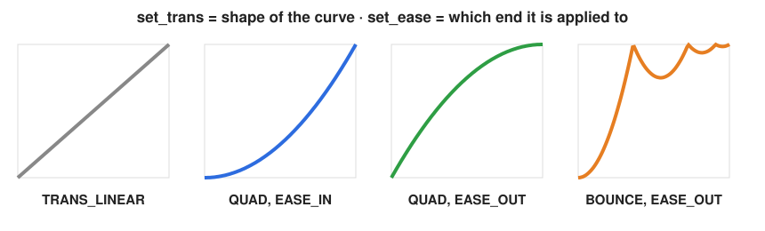
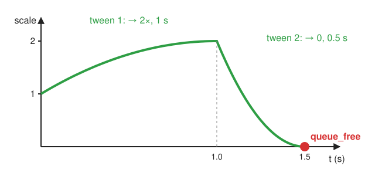

<!-- _class: title -->

# Godot & XR Topics
## Signals, tweens, particles, XR, passthrough and audio

Companion to the Trigonometry, Vectors, Quaternions and Physics slides

Games Engines 1 / XR Prototyping · Dr Bryan Duggan · TU Dublin

---

# FOSS

**F**ree and **O**pen **S**ource **S**oftware: free to use, and the **source code** is available for anyone to read, modify and redistribute (Godot: MIT licence; Blender: GPL).

**Why it matters**
- **No licence fees or royalties** — Unity and Unreal have had runtime fees / revenue share; Godot never will
- **You own your game and your tools** — no company can change the terms or shut it down
- **Read and fix the engine** — the source is on GitHub; you can debug into it, patch bugs, add features
- **Community** — plugins (OpenXR Vendors, Debug Draw 3D), tutorials, contributions
- **Longevity & education** — anyone, anywhere, can learn and use it

---

# Signals: Godot's Observer pattern

**Observer pattern**: a *subject* broadcasts events; *observers* subscribe. The subject doesn't know who's listening → **loose coupling**.

```gdscript
# Responding to collisions (built-in signals)
func _ready() -> void:
    $Area3D.body_entered.connect(_on_body_entered)

func _on_body_entered(body: Node3D) -> void:
    print("Collided with: ", body.name)
```

```gdscript
# Declaring and emitting your own
signal health_changed(new_health: int)
signal died

func take_damage(amount: int) -> void:
    health -= amount
    health_changed.emit(health)          # the HUD listens for this
    if health <= 0:
        died.emit()                      # game manager, sound, score all listen
```

Connect in the editor (*Node → Signals* tab) or in code with `signal.connect(callable)`.

---

# Null safety

```gdscript
var color = b.get_node("MeshInstance3D").get_surface_override_material(0).albedo_color
```

If `b` has **no `MeshInstance3D` child**, `get_node` returns `null` and logs an error; calling a method on `null` **crashes** (stops the game in the debugger). Same if there is no override material.

```gdscript
var mesh = b.get_node_or_null("MeshInstance3D")    # no error, just null
if mesh is MeshInstance3D:
    var mat = mesh.get_surface_override_material(0)
    if mat is StandardMaterial3D:
        var color = mat.albedo_color
```

Related tools: `has_node()`, `is_instance_valid(obj)` (has it been freed?), `obj.has_method("take_damage")`, `as` casts (`var m := node as MeshInstance3D` gives null instead of an error).

---

<!-- _class: small -->

# Tweens

A **Tween** animates a property from its current value to a final value **over time** — position, scale, rotation, colour, volume… Code-driven, created on the fly, no AnimationPlayer needed.

**Parameterised by**
- **Object** and **property path** (`"scale"`, `"position:y"`, `"modulate:a"`)
- **Final value** and **duration** (seconds)
- **Transition** (`set_trans`) — the curve shape: `LINEAR`, `SINE`, `QUAD`, `CUBIC`, `ELASTIC`, `BOUNCE`, `BACK`…
- **Ease** (`set_ease`) — which end the curve is applied to: `EASE_IN` (start), `EASE_OUT` (end), `EASE_IN_OUT` (both)
- Sequencing: tweeners run **one after another** by default; `set_parallel()` / `.parallel()` runs them together; `set_loops()`, `tween_interval()`, `tween_callback()`



---

<!-- _class: tiny -->

# Coin collect tween

*Grow to twice its size over 1 s, then shrink to nothing over 0.5 s, then be removed — with a single Tween.*

```gdscript
func collect() -> void:
    var t = create_tween().set_trans(Tween.TRANS_QUAD).set_ease(Tween.EASE_OUT)
    t.tween_property(self, "scale", Vector3.ONE * 2.0, 1.0)
    t.tween_property(self, "scale", Vector3.ZERO, 0.5)
    t.tween_callback(queue_free)
```



- `create_tween()` makes a Tween bound to this node; `tween_property(object, property, final, duration)`
- The steps run **in sequence**; `tween_callback(queue_free)` removes the coin at the end
- **`set_trans`** = shape of the curve; **`set_ease`** = whether it's applied at the start, end or both

---

<!-- _class: small -->

# Particle systems

A **particle system** emits **many small, short-lived sprites or meshes** that are simulated together to make effects: fire, smoke, explosions, sparks, rain, snow, magic.

| Setting | Controls |
|---|---|
| `amount`, `lifetime` | how many, how long each lives |
| `one_shot`, `explosiveness` | burst vs continuous |
| **Process material** (`ParticleProcessMaterial`) | **behaviour**: emission shape, direction, spread, initial velocity, gravity, damping, colour & scale over life |
| **Draw pass** (`QuadMesh`, `SphereMesh`…) | **appearance** of each particle |

```gdscript
var explosion: GPUParticles3D = explosion_scene.instantiate()
get_parent().add_child(explosion)
explosion.global_position = global_position
explosion.one_shot = true
explosion.emitting = true
explosion.finished.connect(explosion.queue_free)
```

`GPUParticles3D` (fast, thousands) vs `CPUParticles3D` (works everywhere). See *gpu_particles_slides.md*.

---

# Why the Android SDK for Quest 3?

The **Meta Quest 3 runs Android** (Horizon OS is built on Android, ARM64 CPU). To run a Godot game on it you must build an **Android app (APK)**:

- **Build tools** (Gradle, platform tools, build-tools, NDK) to compile and **package** the game as an APK for ARM64
- **ADB** (Android Debug Bridge) to **install, launch and debug** on the headset over USB / Wi-Fi — the *Remote Debug / One-click deploy* button
- **Signing**: a keystore to **sign** the APK (debug or release) — Android won't install unsigned apps
- Plus a **JDK** (Java 17), the **Godot Android export templates**, and **developer mode** on the headset

*Editor Settings → Export → Android* points to the SDK and keystore; *Project → Export → Android* preset with XR Mode = **OpenXR**, *Use Gradle Build*.

---

# Godot OpenXR Vendors plugin

**OpenXR** is the open, cross-vendor standard API for XR; Godot supports the core of it. The **OpenXR Vendors plugin** adds what's specific to each headset maker (Meta, Pico, HTC, Magic Leap, Android XR…):

- **Vendor loaders** — the Android OpenXR loader each headset needs (*Meta XR Features* in the export preset)
- **Vendor extensions**: **passthrough**, hand tracking & hand meshes, scene understanding / room mesh, spatial anchors, body & face & eye tracking, foveated rendering, display refresh rate, render model of the controllers
- **Export settings & manifest** entries for publishing to each store

Install from the Asset Library (or GitHub release), enable it in *Project Settings → Plugins*, enable the features you need in the Android export preset.

---

# XR scene hierarchy

```
Root (Node3D)
├── start_passthrough (Node)               script that starts OpenXR + passthrough
├── WorldEnvironment
├── DirectionalLight3D
├── XROrigin3D                             centre of the play space
│   ├── XRCamera3D                         follows the headset
│   ├── left (XRController3D)              tracker = left_hand
│   │   ├── MeshInstance3D                 visual hand / controller
│   │   └── hand (Area3D)
│   │       └── CollisionShape3D           small SphereShape3D
│   └── right (XRController3D)             tracker = right_hand
│       ├── MeshInstance3D
│       └── hand (Area3D)
│           └── CollisionShape3D
├── Ground (StaticBody3D)                  for VR; omit in MR — the real floor is there
│   ├── CollisionShape3D
│   └── MeshInstance3D
└── piano (Node3D)                         piano.gd
    └── key (Area3D) × 12                  key.gd
        ├── CollisionShape3D
        └── MeshInstance3D
```

---

# The nodes and how they relate

- **`XROrigin3D`** — the origin of the player's **real-world play space**. Tracked nodes are positioned **relative to it**, so they **must be its children**. Move the origin to teleport / move the player.
- **`XRCamera3D`** — child of the origin. Takes the **headset's** position & rotation, renders the **stereo** view (one image per eye).
- **`XRController3D`** ×2 — children of the origin, `tracker` = `left_hand` / `right_hand`. Follow the **hands or controllers**; give button/trigger input (`button_pressed` signal, `get_float("trigger")`).
- **Hand `Area3D`** — child of each controller, so it **moves with the hand** and other areas (piano keys, the cube) can detect it.
- **Piano / ground** — **not** children of the origin: they stay put in the room when the player moves.

Camera and controllers are **siblings**; the origin is their common parent coordinate space.

---

<!-- _class: small -->

# Passthrough

**Passthrough** shows the **real world** — from the headset's cameras — **behind** the virtual content. The player sees the piano floating in their own room: **mixed reality**.

**In Godot**
1. Enable **OpenXR** (*Project Settings → XR → OpenXR*, and *Shaders* enabled), install the **OpenXR Vendors** plugin
2. In the Android export preset enable **Passthrough** under *Meta XR Features*
3. Make the viewport **transparent** and the Environment background **Clear Color**, so nothing is drawn behind the scene
4. **Start passthrough** / set the environment **blend mode** to alpha blend

```gdscript
func enable_passthrough() -> bool:
    get_viewport().use_xr = true
    get_viewport().transparent_bg = true
    environment.background_mode = Environment.BG_CLEAR_COLOR
    environment.ambient_light_source = Environment.AMBIENT_SOURCE_COLOR
    var modes: Array = xr_interface.get_supported_environment_blend_modes()
    if XRInterface.XR_ENV_BLEND_MODE_ALPHA_BLEND in modes:
        return xr_interface.set_environment_blend_mode(XRInterface.XR_ENV_BLEND_MODE_ALPHA_BLEND)
    if xr_interface.is_passthrough_supported():          # older API
        return xr_interface.start_passthrough()
    return false
```

---

# Starting OpenXR

```gdscript
extends Node      # start_passthrough.gd

@export var environment: Environment
var xr_interface: XRInterface

func _ready() -> void:
    xr_interface = XRServer.find_interface("OpenXR")
    if xr_interface and xr_interface.is_initialized():
        DisplayServer.window_set_vsync_mode(DisplayServer.VSYNC_DISABLED)   # headset sets the rate
        get_viewport().use_xr = true
        enable_passthrough()
    else:
        print("OpenXR not initialised — is the headset connected?")
```

---

# Detecting hands: use an Area3D on the hand

`XRController3D` is a plain `Node3D` — **not a physics body**. A `body_entered` signal will **never** report it. Give each hand an **`Area3D`** with a small sphere and detect it with **`area_entered`**.

```gdscript
func _on_area_entered(area: Area3D) -> void:
    if area.is_in_group("hand"):        # or area.name.contains("hand")
        ...
```

(Alternatives: make the hand a `CharacterBody3D`/`AnimatableBody3D` and use `body_entered`; or put the hand areas on their own collision layer and set the key's mask to only that layer.)

---

<!-- _class: tiny -->

# A cube that grows when you touch it

*Expand by 10% when the player's hand is inside, return to normal when it leaves.*

```gdscript
extends Area3D                  # Cube: Area3D → CollisionShape3D (BoxShape3D) + MeshInstance3D

var original_scale: Vector3
var target_scale: Vector3
var hands_inside := 0           # count, so two hands work properly

func _ready() -> void:
    original_scale = scale
    target_scale = scale
    area_entered.connect(_on_area_entered)
    area_exited.connect(_on_area_exited)

func _on_area_entered(area: Area3D) -> void:
    if area.is_in_group("hand"):
        hands_inside += 1
        target_scale = original_scale * 1.1          # +10%

func _on_area_exited(area: Area3D) -> void:
    if area.is_in_group("hand"):
        hands_inside = max(hands_inside - 1, 0)
        if hands_inside == 0:
            target_scale = original_scale

func _process(delta: float) -> void:
    scale = scale.lerp(target_scale, min(10.0 * delta, 1.0))   # smooth
```

Scaling the Area3D scales its shape too — scale the `MeshInstance3D` instead if the hand shouldn't fall out of the bigger box. A Tween also works.

---

<!-- _class: small -->

# A piano key

```gdscript
extends Area3D        # key.gd

signal pressed(note: int)

@export var note: int = 0
@onready var mesh: MeshInstance3D = $MeshInstance3D
var rest_y: float
var t: Tween

func _ready() -> void:
    rest_y = mesh.position.y
    area_entered.connect(_on_area_entered)

func _on_area_entered(area: Area3D) -> void:
    if area.name.contains("hand"):           # detect the player's hand
        pressed.emit(note)                    # tell the piano which note
        animate()

func animate() -> void:
    if t:
        t.kill()                              # a fast repeat restarts the movement
    t = create_tween().set_trans(Tween.TRANS_QUAD).set_ease(Tween.EASE_OUT)
    t.tween_property(mesh, "position:y", rest_y - 0.01, 0.05)   # down 1 cm
    t.tween_property(mesh, "position:y", rest_y, 0.15)          # back up
```

The piano connects every key: `key.pressed.connect(play_note)`. The **mesh** moves, not the Area3D, so the collision shape stays still and doesn't re-trigger.

---

# One sample, twelve notes

Each **semitone** up multiplies the frequency by $2^{1/12}$ (12 semitones = an octave = double the frequency). `pitch_scale` multiplies the playback rate, so a key *n* semitones above the recording uses:

$$\text{pitch\_scale} = 2^{n/12}$$

**7 semitones** (a perfect fifth): $2^{7/12} = 1.498$

| n | 0 | 1 | 2 | 3 | 4 | 5 | 6 | 7 | 8 | 9 | 10 | 11 | 12 |
|---|---|---|---|---|---|---|---|---|---|---|---|---|---|
| scale | 1.000 | 1.059 | 1.122 | 1.189 | 1.260 | 1.335 | 1.414 | **1.498** | 1.587 | 1.682 | 1.782 | 1.888 | 2.000 |

```gdscript
player.pitch_scale = pow(2.0, semitones / 12.0)     # 12.0! int / int would truncate
```

(Speeding up a sample also makes it **shorter** — fine for a game; real samplers use a few recordings.)

---

<!-- _class: tiny -->

# Chords and polyphony

**Problem**: one `AudioStreamPlayer3D` plays one sound. Calling `play()` again **cuts off** the note already playing → only the **last note of the chord** is heard. It also has only **one `pitch_scale`**.

**Solution**: a **pool** of players, used **round robin** with modulo

```gdscript
extends Node3D       # piano.gd

@export var sample: AudioStream
@export var num_players: int = 16
var players: Array[AudioStreamPlayer3D] = []
var next_player: int = 0

func _ready() -> void:
    for i in range(num_players):
        var p = AudioStreamPlayer3D.new()
        p.stream = sample
        add_child(p)
        players.push_back(p)
    for key in get_children():
        if key.has_signal("pressed"):
            key.pressed.connect(play_note)

func play_note(semitones: int) -> void:
    var p = players[next_player]
    p.pitch_scale = pow(2.0, semitones / 12.0)
    p.play()
    next_player = (next_player + 1) % players.size()     # wrap around
```

`max_polyphony` lets one player overlap copies, but they all share one `pitch_scale`, so it doesn't solve this alone.

---

<!-- _class: small -->

# Checklist

- [ ] Explain `delta`, `_process`, `_physics_process` with numbers
- [ ] Dot product FOV — explain every line, cos 60° = 0.5
- [ ] Spawner with `@export` rows/columns; pyramid
- [ ] Three joints + uses
- [ ] Bullet: `add_child` **before** setting global transforms; why add to the parent
- [ ] Angle → vector for any convention, with a diagram
- [ ] HSV rainbow + float division + own material
- [ ] Tweens: sequence, callback, `set_trans`, `set_ease`
- [ ] Projectile: resolve, v = u + at, s = ut + ½at², symmetry, range
- [ ] Euler integration by hand + why it's wrong + how to fix
- [ ] Torque = r × F by hand; `apply_force` vs `apply_central_force`
- [ ] Turret: Area3D range, slerp, Timer, missile seek, collisions, raycast LOS
- [ ] XR hierarchy, passthrough, hand Area3D, piano key, 2^(n/12), audio pool
- [ ] FOSS, signals/observer, null safety, quaternions, particles, Android SDK, OpenXR Vendors
