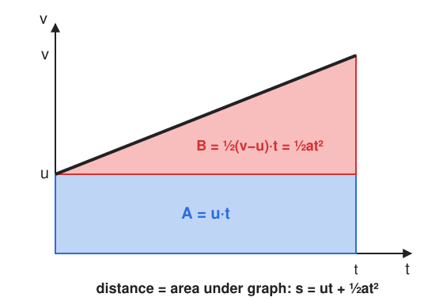
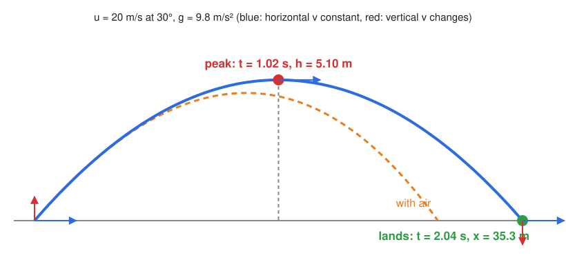
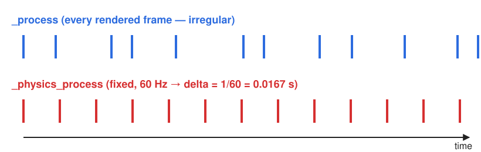
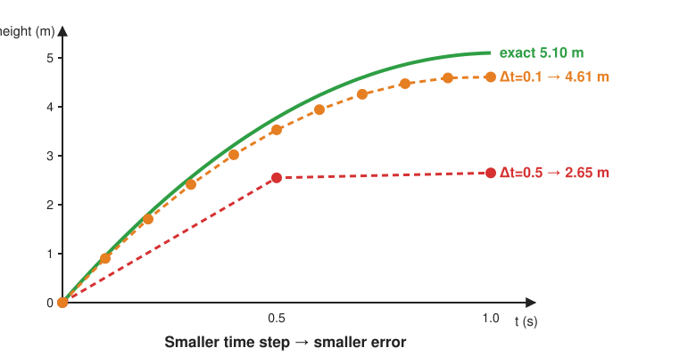
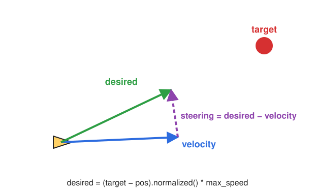
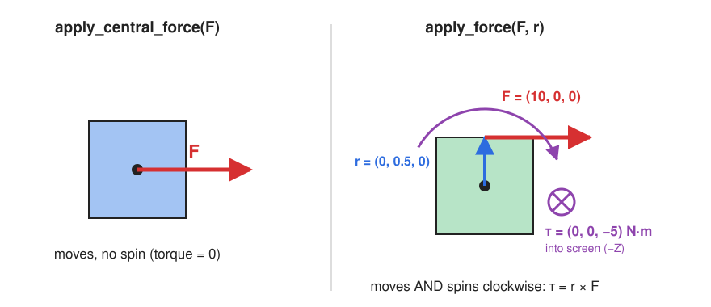
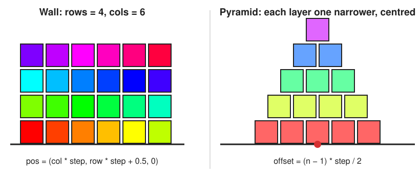
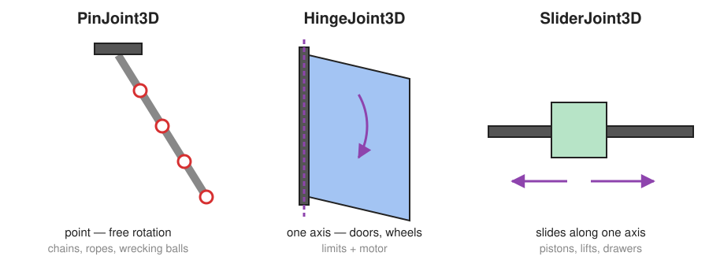
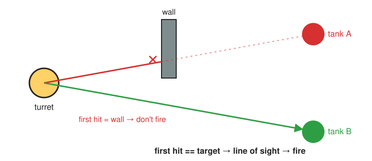

<!-- _class: title -->

# Physics for Games
## Newton, Hamilton & the Godot 4 physics engine

Games Engines 1 / XR Prototyping
Dr Bryan Duggan · TU Dublin

---

# What we will cover

**Part 1 — Motion (Newtonian physics)**
quantities & units · SUVAT · free fall · projectiles · air resistance · forces, F = ma

**Part 2 — Simulating motion**
`_process` vs `_physics_process` · Euler integration & its error · two ways to simulate a ball · steering & homing

**Part 3 — Rotation (Hamiltonian physics)**
torque · `apply_force` vs `apply_central_force` · angular velocity · inertia

**Part 4 — The Godot physics engine**
bodies, shapes, layers, signals · spawning a wall of blocks · joints · raycasts & line of sight · gravity gun

**Part 5 — Worked example: turret & homing missile**

---

<!-- _class: divider -->

# Part 1
## Motion

---

# Quantities and units

| Quantity | Scalar / vector | Unit | Notes |
|---|---|---|---|
| Time *t* | scalar | s | |
| Distance | scalar | m | how far you went |
| Displacement *s* | vector | m | where you ended up relative to the start |
| Mass *m* | scalar | kg | amount of matter; resists acceleration |
| Position *p* | vector | m | of the **centre of mass** (the balance point) |
| Velocity *v* | vector | m/s | $v = \Delta p / \Delta t$; its length is **speed** |
| Acceleration *a* | vector | m/s² | $a = \Delta v / \Delta t$ |
| Force *F* | vector | N = kg·m/s² | $F = ma$ |
| Momentum | vector | kg·m/s | $mv$ |

Godot's physics engine uses **metres, kilograms and seconds**. In XR, 1 unit really is 1 metre.

---

# Velocity and position

$$v = \frac{\Delta p}{\Delta t} \qquad \Rightarrow \qquad \Delta p = v\,\Delta t \qquad \Rightarrow \qquad p_{new} = p_{old} + v\,\Delta t$$

**Examples**
- A ball travels 5 m in 2 s: $v = 5 / 2 = 2.5$ m/s
- An object starts at 5 m and moves at 10 m/s. After 3.5 s: $p = 5 + 10 \times 3.5 = 40$ m

This is exactly what a game does every frame, with Δt = `delta`:

```gdscript
global_position += velocity * delta
```

---

# Acceleration

$$a = \frac{\Delta v}{\Delta t} \qquad \Rightarrow \qquad v = u + at$$

*u* = starting velocity, *v* = velocity after time *t*

A car starts from rest and accelerates at 2 m/s²:

| t (s) | 0 | 1 | 2 | 3 |
|---|---|---|---|---|
| v (m/s) | 0 | 2 | 4 | 6 |

**Example**: a car at 3 m/s accelerates at 2 m/s² for 3 s:
$v = 3 + 2 \times 3 = 9$ m/s

Constant acceleration is a straight line on a velocity–time graph: like $y = mx + c$, with gradient *a* and intercept *u*.

---

# Distance = area under the v–t graph



- Rectangle **A** = $u\,t$
- Triangle **B** = $\frac{1}{2}(v - u)\,t$, and $v - u = at$, so B = $\frac{1}{2}at^2$

$$s = ut + \tfrac{1}{2}at^2$$

**Example** (the car above): $s = 3 \times 3 + \frac{1}{2} \times 2 \times 3^2 = 9 + 9 = 18$ m

---

# The equations of motion (SUVAT)

For **constant** acceleration

| Equation | Doesn't involve |
|---|---|
| $v = u + at$ | *s* |
| $s = ut + \frac{1}{2}at^2$ | *v* |
| $v^2 = u^2 + 2as$ | *t* |
| $s = \frac{1}{2}(u + v)\,t$ | *a* |

**s** displacement · **u** initial velocity · **v** final velocity · **a** acceleration · **t** time

**Method**: write down what you know, what you want, and pick the equation that leaves out the one you don't know and don't want.

Gravity near the Earth: $a = g = 9.8$ m/s² downwards (in Godot, `ProjectSettings.get_setting("physics/3d/default_gravity")`, default 9.8).

---

# Worked example: free fall from 400 m

*An object falls from 400 m in a vacuum. How long does it take, and how fast is it going when it hits the ground?*

Know: $u = 0$, $a = 9.8$, $s = 400$. Want: *t* and *v*. (Taking down as positive.)

**Time** — $s = ut + \frac{1}{2}at^2$ with $u = 0$:
$$400 = \tfrac{1}{2} \times 9.8 \times t^2 \Rightarrow t^2 = \frac{800}{9.8} = 81.63 \Rightarrow t = 9.04 \text{ s}$$

**Speed** — $v = u + at = 0 + 9.8 \times 9.04 = 88.5$ m/s
(check: $v^2 = u^2 + 2as = 2 \times 9.8 \times 400 = 7840 \Rightarrow v = 88.5$ m/s ✓)

**Similar**: dropped from the top of the Empire State Building (381 m): $v = \sqrt{2 \times 9.8 \times 381} = 86.4$ m/s, $t = 86.4 / 9.8 = 8.82$ s

---

# Worked example: the catapult

*A catapult launches a ball from ground level at 20 m/s, 30° above horizontal. No air, g = 9.8. Find the time to the top, the max height, the time in the air and the range.*



Treat **horizontal** and **vertical** separately. Horizontal velocity never changes (no force); vertical is just like throwing a ball straight up.

---

# The catapult: steps

**1. Resolve the velocity** (trig):
$u_x = 20\cos 30° = 17.32$ m/s  $u_y = 20\sin 30° = 10$ m/s

**2. Time to the top** — vertical velocity is 0 there. $v = u + at$:
$0 = 10 - 9.8t \Rightarrow t = 1.02$ s

**3. Max height** — $s = ut + \frac{1}{2}at^2$:
$s = 10 \times 1.02 - \frac{1}{2} \times 9.8 \times 1.02^2 = 5.10$ m  (or $v^2 = u^2 + 2as$: $s = 100/19.6 = 5.10$ ✓)

**4. Time in the air** — the flight is symmetrical: $2 \times 1.02 = 2.04$ s

**5. Range** — horizontal velocity is constant: $17.32 \times 2.04 = 35.3$ m

> Steps: **resolve → vertical (v = u + at, s = ut + ½at²) → symmetry → horizontal distance = speed × time**

---

# What if there was air?

**Air resistance (drag)** is a force that acts **against the velocity**, and grows with speed (roughly $F_d = \frac{1}{2}\rho C_d A v^2$)

- The ball slows down **horizontally and vertically**
- It doesn't go **as high** or **as far** (orange dashed curve on the diagram)
- The path is no longer symmetrical: it comes down **more steeply** than it went up
- A falling object speeds up until drag = gravity, then stops accelerating: **terminal velocity**

$$mg = F_d \Rightarrow v_{terminal} = \sqrt{\frac{2mg}{\rho C_d A}}$$

(A skydiver: about 55 m/s, not the 88 m/s of the 400 m vacuum example.)

In Godot: `RigidBody3D.linear_damp` is a simple drag. ⚠️ Projects default to **0.1** — that's why a Godot catapult ball lands at ~31 m, not 35 m!

---

# Forces and Newton's laws

1. An object keeps moving at a constant velocity unless a **net force** acts on it. *No force is needed to keep an arrow flying — only to start, stop or turn it.*
2. $F = ma$ — so $a = F / m$
3. Every action has an equal and opposite reaction

Forces add up as **vectors** — gravity, the floor pushing up, friction, wind, buoyancy, thrust. If the sum is zero, the velocity doesn't change.

**Example**: a 2000 kg boat accelerating at 1.5 m/s² has a net force of $2000 \times 1.5 = 3000$ N

**So if we know the force, mass and time, we can calculate the acceleration, then the velocity, then the position** 👉 that's a physics engine.

---

<!-- _class: divider -->

# Part 2
## Simulating motion

---

<!-- _class: small -->

# `_process` vs `_physics_process`



| | `_process(delta)` | `_physics_process(delta)` |
|---|---|---|
| Called | once per **rendered frame** | at a **fixed rate** — 60/s by default |
| delta | varies (0.011 s at 90 fps, 0.033 at 30 fps…) | constant (1/60 = 0.0167 s) |
| Use for | input, animation, UI, visuals | movement, forces, collisions, raycasts |

**delta** = time in seconds since the previous call. Multiply movement by it so speeds are in **metres per second, not metres per frame**: at 5 m/s an object moves 0.17 m/frame at 30 fps and 0.06 m/frame at 90 fps, but **5 m every second** in both.

The rate is set in *Project Settings → Physics → Common → Physics Ticks per Second*.

---

# Numerical integration

A physics engine works out the new state from the old one, a small step Δt at a time. **Euler integration**:

```gdscript
var velocity := Vector3.ZERO
var force := Vector3.ZERO      # add all forces here during the step
@export var mass := 1.0

func _physics_process(delta: float) -> void:
    var acceleration = force / mass        # a = F / m
    velocity += acceleration * delta       # v = u + a·Δt
    global_position += velocity * delta    # p = p + v·Δt
    force = Vector3.ZERO                   # forces only last one step

    if velocity.length() > 0.01:           # face the way we're going
        look_at(global_position + velocity, Vector3.UP)
    velocity *= 0.99                       # crude damping (drag)
```

This updates **velocity first, then position** (*semi-implicit* or *symplectic* Euler) — what Godot and most game engines use. It is more stable than updating position first.

---

# Integration error

*Vertical motion: `velocity.y -= 9.8 * delta; position.y += velocity.y * delta`. Launch velocity 10 m/s, Δt = 0.5 s. Height after 1 s?*

| Step | t | velocity = v − 9.8 × 0.5 | height = h + v × 0.5 |
|---|---|---|---|
| 0 | 0 | 10 | 0 |
| 1 | 0.5 | 10 − 4.9 = **5.1** | 0 + 5.1 × 0.5 = **2.55** |
| 2 | 1.0 | 5.1 − 4.9 = **0.2** | 2.55 + 0.2 × 0.5 = **2.65 m** |

**Exact**: $s = ut + \frac{1}{2}at^2 = 10 \times 1 - \frac{1}{2} \times 9.8 \times 1^2 = 5.10$ m

**Simulated: 2.65 m** — about half the true height!

---

<!-- _class: small -->

# Why the error, and how to reduce it



**Why**: Euler integration assumes the velocity is **constant for the whole step**. Gravity changes it **continuously**, so each step adds error.

**Reduce it**:
- **Smaller time step**: Δt = 0.1 → 4.61 m; Godot's 1/60 → **5.02 m**
- **Better integrator**: Verlet, Runge-Kutta (RK4 samples several times per step)
- **Exact equation** when acceleration is constant:
  `position += velocity * dt + 0.5 * a * dt * dt` then `velocity += a * dt`

Error for this example: $\approx \frac{1}{2} g\,T\,\Delta t$ — halve Δt, halve the error.

---

# Explicit vs semi-implicit Euler

| Order of updates | 2 steps of 0.5 s | Behaviour |
|---|---|---|
| **position then velocity** (explicit) | 7.55 m | overshoots, gains energy, orbits spiral outwards |
| **velocity then position** (semi-implicit) | 2.65 m | undershoots here, but conserves energy well — stable |
| **exact** (½at²) | **5.10 m** | correct for constant *a* only |

Both errors shrink as Δt shrinks. This is why physics runs at a **fixed** step: the same inputs always give the same results, and a slow frame can't cause a huge step that pushes objects through walls.

---

<!-- _class: small -->

# Simulating the ball: approach 1 — integrate in a script

Store the velocity, add gravity, move, and **clamp to the ground** when it lands

```gdscript
extends Node3D

@export var launch_speed: float = 20.0
@export var launch_angle: float = 30.0
var velocity: Vector3
var gravity = Vector3(0, -9.8, 0)
var landed := false

func _ready() -> void:
    var a = deg_to_rad(launch_angle)
    velocity = Vector3(cos(a), sin(a), 0) * launch_speed

func _physics_process(delta: float) -> void:
    if landed:
        return
    velocity += gravity * delta
    global_position += velocity * delta
    if global_position.y <= 0.0:
        global_position.y = 0.0          # stop it penetrating the ground
        velocity = Vector3.ZERO
        landed = true                    # stop updating: no bouncing
```

Full control, predictable, cheap. But it won't collide with anything except y = 0.

---

<!-- _class: small -->

# Approach 2 — let the physics engine do it

`RigidBody3D` + `CollisionShape3D`, a `StaticBody3D` floor. Launch with an **impulse** of mass × velocity.

```gdscript
extends RigidBody3D

@export var launch_speed: float = 20.0
@export var launch_angle: float = 30.0
var flight_time := 0.0
var landed := false

func _ready() -> void:
    linear_damp_mode = RigidBody3D.DAMP_MODE_REPLACE
    linear_damp = 0.0                     # remove the default 0.1 "air resistance"
    contact_monitor = true                # needed for body_entered on a RigidBody3D
    max_contacts_reported = 1
    body_entered.connect(_on_body_entered)
    var a = deg_to_rad(launch_angle)
    apply_central_impulse(Vector3(cos(a), sin(a), 0) * launch_speed * mass)

func _physics_process(delta: float) -> void:
    if not landed:
        flight_time += delta

func _on_body_entered(_body: Node) -> void:
    if flight_time > 0.1:                 # ignore touching the ground at launch
        landed = true
        set_deferred("freeze", true)      # stop it bouncing or rolling
```

---

# Stopping penetration and bouncing

| Problem | Fix |
|---|---|
| Ball sinks through the ground (script approach) | clamp `y` to the ground height and stop updating |
| Fast object **tunnels** through thin walls | `continuous_cd = true` (CCD), thicker colliders, smaller Δt |
| Bounces around | `PhysicsMaterial` with `bounce = 0`, higher `friction`; or `freeze` on landing |
| Rolls forever | `angular_damp`, friction, or `freeze` / `sleeping` |
| Freezes at launch | it's touching the ground on frame 1 — ignore early contacts, or start it slightly above |
| Different range to the maths | default `linear_damp` 0.1, integration error |

> Change physics state (`freeze`, `add_child` of bodies, disabling shapes) with **`set_deferred`** inside collision callbacks — the physics server is busy during them.

---

# Steering: seek



Reynolds' steering behaviours produce a **force**, then integrate with F = ma

$$\text{desired} = \widehat{(\text{target} - \text{pos})} \times \text{max\_speed}$$
$$\text{steering} = \text{desired} - \text{velocity}$$

```gdscript
func seek(target_pos: Vector3) -> Vector3:
    var desired = (target_pos - global_position) \
            .normalized() * max_speed
    return desired - velocity

func _physics_process(delta):
    var force = seek(target.global_position) \
            .limit_length(max_force)
    velocity += force / mass * delta
    velocity = velocity.limit_length(max_speed)
    global_position += velocity * delta
    look_at(global_position + velocity, Vector3.UP)
```

---

# Arrive

Seek overshoots and orbits. **Arrive** slows down inside a radius:

```gdscript
@export var slowing_distance := 10.0

func arrive(target_pos: Vector3) -> Vector3:
    var to_target = target_pos - global_position
    var dist = to_target.length()
    if dist < 0.01:
        return -velocity                                   # brake
    var speed = max_speed * min(dist / slowing_distance, 1.0)   # ramps down
    var desired = to_target / dist * speed
    return desired - velocity
```

Other behaviours (flee, pursue, wander, obstacle avoidance, flocking) all return a force that is **added up** and integrated the same way — see *Games Engines 2*.

---

<!-- _class: divider -->

# Part 3
## Rotation

---

<!-- _class: small -->

# Torque



**Torque** is the turning effect of a force. It is the **cross product** of the offset from the centre of mass (**r**) and the force (**F**):

$$\tau = \mathbf{r} \times \mathbf{F}$$

- **Direction** of τ = the **axis** of rotation (right-hand rule)
- **Length** of τ = **how much** torque (N·m) = |r||F| sin θ — a longer lever or a bigger force turns more

---

# Worked example: force (10, 0, 0) N at offset (0, 0.5, 0) m

$$
\tau = (0, 0.5, 0) \times (10, 0, 0)
$$

Using $\mathbf{a}\times\mathbf{b} = (a_y b_z - a_z b_y,\ a_z b_x - a_x b_z,\ a_x b_y - a_y b_x)$:

$$
\tau = (0.5 \times 0 - 0 \times 0,\ \ 0 \times 10 - 0 \times 0,\ \ 0 \times 0 - 0.5 \times 10) = (0,\ 0,\ -5) \text{ N·m}
$$

A torque of **5 N·m around the −Z axis**: pushing the top of the box to the right tips it **clockwise** as seen from the front.

```gdscript
var torque = Vector3(0, 0.5, 0).cross(Vector3(10, 0, 0))   # (0, 0, -5)
```

---

<!-- _class: small -->

# `apply_force` vs `apply_central_force`

| Method | Acts at | Effect |
|---|---|---|
| `apply_central_force(F)` | centre of mass | accelerates, **no torque**, doesn't spin |
| `apply_force(F, offset)` | `offset` from the centre (global orientation) | **same** linear acceleration **plus** torque r × F → spins |
| `apply_torque(τ)` | — | spins only |
| `apply_central_impulse(J)`, `apply_impulse(J, offset)`, `apply_torque_impulse` | | instant change in velocity (one-shot: jumps, explosions, launches) |
| `add_constant_force(F)`, `add_constant_torque(τ)` | | keeps applying every step until removed (thrusters) |

**Force vs impulse**: `apply_force` lasts **one physics step** — call it every `_physics_process`. An impulse (N·s = kg·m/s) changes the momentum immediately: Δv = J / m.

```gdscript
extends RigidBody3D   # rb_test.gd from the repo
var power = 0.1
func _physics_process(delta: float) -> void:
    if Input.is_key_pressed(KEY_Y): add_constant_force(Vector3.UP * power)
    if Input.is_key_pressed(KEY_H): apply_torque(Vector3.FORWARD * power)
    if Input.is_key_pressed(KEY_L): apply_force(Vector3.DOWN * power, Vector3(0, 0, -2))
```

---

# Angular velocity, acceleration and inertia

| Linear | Rotational |
|---|---|
| position *p* (m) | orientation *q* (quaternion) |
| velocity *v* (m/s) | **angular velocity** ω (rad/s) — a vector: the axis, length = speed of spin |
| acceleration *a* | **angular acceleration** α (rad/s²) |
| force *F* | **torque** τ |
| mass *m* | **moment of inertia** *I* (a 3×3 **inertia tensor**) |
| $F = ma$ | $\tau = I\alpha$ |

**Inertia** resists changes in motion: mass for movement, the inertia tensor for rotation. It depends on **how the mass is spread out** — a figure skater spins faster when they pull their arms in.

The Earth's angular velocity: 15° per hour around its axis.

---

# The inertia tensor

A *tensor* generalises scalars (rank 0), vectors (rank 1) and matrices (rank 2). The inertia tensor is a rank-2 tensor: a 3×3 matrix. For a **box** of mass *m*, width *w*, height *h*, depth *d*:

$$
I = \begin{pmatrix} \frac{m(h^2+d^2)}{12} & 0 & 0 \\ 0 & \frac{m(w^2+d^2)}{12} & 0 \\ 0 & 0 & \frac{m(w^2+h^2)}{12} \end{pmatrix}
\qquad \text{Solid sphere: } I = \tfrac{2}{5}mr^2
$$

**Example**: 1 kg, 1 m cube: $I = 1 \times (1 + 1) / 12 = 0.167$ on each axis. Our 5 N·m torque gives $\alpha = \tau / I = 5 / 0.167 = 30$ rad/s².

Godot calculates the inertia from the **collision shapes** automatically (`RigidBody3D.inertia = Vector3.ZERO` means *auto*). Approximating a complex shape with a simple one is fine — will anyone notice?

---

# Equations of motion — both kinds

**Newtonian (linear)**
$$a = F/m \qquad v \mathrel{+}= a\,\Delta t \qquad p \mathrel{+}= v\,\Delta t$$

**Hamiltonian (rotational)**
$$\tau = r \times F \qquad \alpha = I^{-1}\tau \qquad \omega \mathrel{+}= \alpha\,\Delta t \qquad q \mathrel{+}= \tfrac{\Delta t}{2}\,\omega\,q$$

Two ways to add a force to a body:
1. **At the centre of mass** → add to the **force** accumulator only
2. **At a point** → add to the force accumulator **and** add r × F to the **torque** accumulator

Each step: integrate, then clear the accumulators. You can hook in with `_integrate_forces(state)`:

```gdscript
func _integrate_forces(state: PhysicsDirectBodyState3D) -> void:
    state.apply_central_force(-state.linear_velocity * drag)   # custom drag
```

---

<!-- _class: divider -->

# Part 4
## The Godot physics engine

---

# What does a physics engine do?

Simulates physical systems in **real time**, sacrificing accuracy for speed (*will anyone notice?*)

- **Rigid body dynamics** — bodies that never deform
- **Collision detection** — between primitives and triangle meshes
- **Collision response** — push apart, bounce, friction
- **Constraints / joints**
- **Queries** — raycasts, shape casts, overlaps
- (Soft bodies, cloth, fluids — in some engines)

Godot 4 ships two 3D engines: **Godot Physics** and **Jolt** (*Project Settings → Physics → 3D → Physics Engine*). Jolt (used in Horizon Forbidden West) is faster and more stable for stacks of objects. Others: PhysX (Unity, older Unreal), Havok, Bullet, Box2D.

A rigid body has **constant** mass and inertia tensor, and **changing** position, velocity, orientation (quaternion) and angular velocity.

---

# Physics body nodes

| Node | Moved by | Use for |
|---|---|---|
| `StaticBody3D` | nothing (doesn't move) | floors, walls, terrain |
| `RigidBody3D` | **the physics engine** (forces, gravity, collisions) | crates, balls, debris, wall blocks |
| `CharacterBody3D` | **your code** via `velocity` + `move_and_slide()` | players, tanks, NPCs |
| `AnimatableBody3D` | code / animation, pushes others | moving platforms, doors, lifts |
| `Area3D` | your code — **detects overlaps, no collision response** | triggers, pickups, ranges, bullets, hands in XR |

Every one needs a **`CollisionShape3D`** child (or several) to collide. The `MeshInstance3D` is only what you **see** — the shape is what the physics engine uses.

A `RigidBody3D` with `freeze = true` stops simulating (`FREEZE_MODE_STATIC` or `FREEZE_MODE_KINEMATIC`).

---

# Collision shapes

| Shape | Speed | Notes |
|---|---|---|
| `SphereShape3D`, `BoxShape3D`, `CapsuleShape3D`, `CylinderShape3D` | ⚡ fastest | use these whenever you can |
| `ConvexPolygonShape3D` | fast | wraps a mesh like cling film. *Mesh → Create Convex Collision Sibling* |
| `ConcavePolygonShape3D` (trimesh) | slow | exact shape, **only for static bodies** (level geometry) |
| `HeightMapShape3D`, `WorldBoundaryShape3D` | | terrain, infinite floor |

The collider **doesn't have to match** the mesh — a capsule for a character, a few boxes for a car. Lower detail = faster and more stable.

⚠️ **Don't scale** collision shapes non-uniformly through the node's scale — change the shape's size property instead.

---

# Collision layers and masks

- **Layer**: which layers this object **is on**
- **Mask**: which layers this object **looks for** / collides with

| Object | Layer | Mask |
|---|---|---|
| Player | 1 player | 2, 3, 4 |
| Enemies | 2 enemy | 1, 3, 4 |
| World | 3 world | — |
| Player bullets | 4 player_bullet | 2, 3 — **not 1**, so you can't shoot yourself |

Name the layers in *Project Settings → Layer Names → 3D Physics*.

```gdscript
bullet.collision_mask = 0b0110          # layers 2 and 3
set_collision_mask_value(1, false)       # stop seeing layer 1
```

---

<!-- _class: small -->

# Collision signals (Observer pattern)

| Node | Signal(s) | Needs |
|---|---|---|
| `Area3D` | `body_entered/exited(body)`, `area_entered/exited(area)` | `monitoring = true` (default) |
| `RigidBody3D` | `body_entered/exited(body)` | `contact_monitor = true` and `max_contacts_reported > 0` |
| `CharacterBody3D` | — use `get_slide_collision(i)` after `move_and_slide()` | |

```gdscript
func _ready() -> void:
    $Area3D.body_entered.connect(_on_body_entered)

func _on_body_entered(body: Node3D) -> void:
    if body.is_in_group("player"):         # filter with groups...
        body.add_coins()
    if body.has_method("take_damage"):      # ...or duck typing
        body.take_damage(20)
```

The object emitting the signal doesn't need to know who is listening — that's the **Observer pattern**.

---

# CharacterBody3D movement

```gdscript
extends CharacterBody3D

@export var speed := 5.0
@export var jump_velocity := 4.5
@export var turn_speed := 2.0

func _physics_process(delta: float) -> void:
    if not is_on_floor():
        velocity += get_gravity() * delta        # integrate gravity ourselves

    if Input.is_action_just_pressed("jump") and is_on_floor():
        velocity.y = jump_velocity

    rotate_y(Input.get_axis("right", "left") * turn_speed * delta)   # tank steering
    var move = Input.get_axis("back", "forward")
    var forward = -global_basis.z
    velocity.x = forward.x * move * speed
    velocity.z = forward.z * move * speed

    move_and_slide()       # moves by velocity * delta, slides along walls, updates is_on_floor()
```

`move_and_slide()` multiplies by delta **for you** — don't multiply velocity by delta first!

---

# Spawning a wall of physics blocks



1. Make a **block scene**: `RigidBody3D` root → `CollisionShape3D` (BoxShape3D) + `MeshInstance3D` (BoxMesh)
2. Make a **Spawner** script with `@export` variables for the scene, rows and columns — they appear in the **Inspector**
3. Nested loops → `instantiate()` → `add_child()` → set the position

---

# The wall spawner

```gdscript
extends Node3D       # wall_spawner.gd

@export var block_scene: PackedScene
@export var rows: int = 5          # editable in the Godot editor
@export var columns: int = 8
@export var block_size: float = 1.0
@export var gap: float = 0.05

func _ready() -> void:
    var step = block_size + gap
    var offset = (columns - 1) * step / 2.0          # centre the wall on the spawner
    for row in range(rows):
        for col in range(columns):
            var block = block_scene.instantiate()
            add_child(block)
            block.position = Vector3(col * step - offset, row * step + block_size / 2.0, 0)
            var mat = StandardMaterial3D.new()        # rainbow — see the trig slides
            mat.albedo_color = Color.from_hsv(float(col) / columns, 1, 1)
            block.get_node("MeshInstance3D").set_surface_override_material(0, mat)
```

Add `@tool` and redraw in the editor to see the wall as you change the numbers. Blocks start touching the floor (y = size/2) so they don't fall and jiggle.

---

# Variants: a pyramid, and blocks built in code

**Pyramid** — each layer one narrower, centred

```gdscript
@export var layers: int = 5
func _ready() -> void:
    var step = 1.0 + gap
    for y in range(layers):
        var n = layers - y                       # blocks in this layer
        var offset = (n - 1) * step / 2.0
        for x in range(n):
            for z in range(n):                   # 3D pyramid; drop this loop for 2D
                var block = block_scene.instantiate()
                add_child(block)
                block.position = Vector3(x * step - offset, y + 0.5, z * step - offset)
```

**No scene at all** — build the nodes in code

```gdscript
var block = RigidBody3D.new()
var shape = CollisionShape3D.new();  shape.shape = BoxShape3D.new()
var mesh = MeshInstance3D.new();     mesh.mesh = BoxMesh.new()
block.add_child(shape);  block.add_child(mesh)
add_child(block)
block.position = Vector3(x * 1.1, y * 1.1 + 0.5, 0)
```

---

# Joints



A **joint** (constraint) limits how two physics bodies can move relative to each other. The two bodies go in **`node_a`** and **`node_b`** (leave one empty to attach to the world).

---

# The joint types

| Joint | Constrains | Game example |
|---|---|---|
| `PinJoint3D` | joined at one **point**, rotate freely | chains, ropes, wrecking ball, rag-doll hips |
| `HingeJoint3D` | rotate around **one axis**; limits & **motor** | doors, wheels, flippers, see-saws |
| `SliderJoint3D` | move along **one axis**, with limits | pistons, lifts, drawers, sliding doors |
| `ConeTwistJoint3D` | swing in a cone + twist | rag-doll shoulders, tails |
| `Generic6DOFJoint3D` | each of 6 axes locked, limited, free, or with springs/motors | suspension, anything custom |

(Unity's SpringJoint → Generic6DOF with springs; FixedJoint → lock all 6 axes, or just parent it.)

---

<!-- _class: small -->

# Joints in code

**A chain of pinned links**

```gdscript
@export var link_scene: PackedScene
@export var links := 10

func _ready() -> void:
    var prev: PhysicsBody3D = $Anchor              # a StaticBody3D at the top
    for i in range(links):
        var link = link_scene.instantiate()        # RigidBody3D capsule
        add_child(link)
        link.position = Vector3(0, -(i + 1) * 0.5, 0)
        var pin = PinJoint3D.new()
        add_child(pin)
        pin.position = Vector3(0, -(i + 0.5) * 0.5, 0)   # between the two links
        pin.node_a = pin.get_path_to(prev)             # set AFTER both are in the tree
        pin.node_b = pin.get_path_to(link)
        prev = link
```

**A motorised hinge (a wheel)**

```gdscript
hinge.set_flag(HingeJoint3D.FLAG_ENABLE_MOTOR, true)
hinge.set_param(HingeJoint3D.PARAM_MOTOR_TARGET_VELOCITY, 10.0)   # rad/s
hinge.set_param(HingeJoint3D.PARAM_MOTOR_MAX_IMPULSE, 50.0)
```

---

# Raycasting

A **ray** from an origin in a direction, returning the **first** thing it hits. Very cheap — hundreds per frame is fine.

**Option 1: a `RayCast3D` node** (good for something you check every frame)

```gdscript
@onready var ray: RayCast3D = $RayCast3D     # target_position = (0, 0, -50)
func _physics_process(delta):
    if ray.is_colliding():
        print(ray.get_collider().name, " at ", ray.get_collision_point())
```

**Option 2: a query in code** (good for one-off checks)

```gdscript
func cast(from: Vector3, to: Vector3) -> Dictionary:
    var space = get_world_3d().direct_space_state
    var query = PhysicsRayQueryParameters3D.create(from, to)
    query.exclude = [self.get_rid()]           # don't hit yourself (if a CollisionObject3D)
    return space.intersect_ray(query)          # {} if nothing hit, else:
    # result.position, result.normal, result.collider, result.collider_id, result.shape
```

Uses: shooting (hitscan), line of sight, ground checks, AI feelers, placing objects, XR pointers.

---

<!-- _class: small -->

# Line of sight



*The turret should not fire if there is a wall between it and the tank.*

Cast a ray from the muzzle to the tank. Only fire if the **first thing hit is the tank**.

```gdscript
func has_line_of_sight() -> bool:
    var space = get_world_3d().direct_space_state
    var query = PhysicsRayQueryParameters3D.create(
            muzzle.global_position, target.global_position)
    var result = space.intersect_ray(query)
    return not result.is_empty() \
            and result.collider == target

func _fire() -> void:
    if not has_line_of_sight():
        return
    # ...fire as before
```

Physics queries are only safe **during the physics step** → set the FireTimer's *Process Callback* to **Physics**. (Or use a `RayCast3D` + `force_raycast_update()` + `get_collider()`.)

---

<!-- _class: small -->

# Example: a gravity gun

Popularised by *Half-Life 2*; also Portal, BioShock, Crysis, Dead Space. Pick up physics objects and throw them.

1. On click, if nothing is held, **raycast** from the camera forward
2. If it hits a `RigidBody3D`, hold it
3. Every physics step: **hold point** = a few metres in front of the camera. Set the body's velocity towards it
4. On release, **throw** with an impulse along the camera's forward

```gdscript
extends Camera3D
@export var hold_distance := 3.0
@export var pull := 10.0
var held: RigidBody3D = null

func _physics_process(delta: float) -> void:
    if Input.is_action_just_pressed("shoot") and held == null:
        var hit = get_world_3d().direct_space_state.intersect_ray(
            PhysicsRayQueryParameters3D.create(global_position, global_position - global_basis.z * 50))
        if not hit.is_empty() and hit.collider is RigidBody3D:
            held = hit.collider
    elif Input.is_action_just_pressed("shoot") and held:
        held.apply_central_impulse(-global_basis.z * 20.0 * held.mass)   # throw
        held = null
    if held:
        var hold_pos = global_position - global_basis.z * hold_distance
        held.linear_velocity = (hold_pos - held.global_position) * pull
```

---

<!-- _class: divider -->

# Part 5
## Worked example: turret & homing missile

---

<!-- _class: small -->

# The brief

> A sentry turret guards a base. When the player's tank comes within **30 m**, the head of the turret **smoothly turns** to face the tank and fires a **homing missile** from the end of its barrel **every 2 seconds**. A missile **steers towards the tank** as it flies. It **explodes** when it hits something and takes **20** from the tank's health if it hits the tank. It **removes itself after 8 seconds** if it has not hit anything.

```
Turret (Node3D)                turret.gd
├── Base (MeshInstance3D)
├── Head (Node3D)              the part that turns
│   ├── MeshInstance3D         head and barrel
│   └── Muzzle (Marker3D)      end of the barrel, -Z points out
├── Range (Area3D)
│   └── CollisionShape3D       SphereShape3D, radius 30
└── FireTimer (Timer)          wait_time = 2

Missile (Area3D)               missile.gd
├── CollisionShape3D
├── MeshInstance3D
└── LifeTimer (Timer)          wait_time = 8, one_shot, autostart
```

Detection & smooth turning: see the **quaternion** slides (Area3D `body_entered` + slerp).

---

<!-- _class: small -->

# Firing

```gdscript
# turret.gd (continued)
@onready var muzzle: Marker3D = $Head/Muzzle

func _ready() -> void:
    # ...range signals as before...
    fire_timer.timeout.connect(_fire)

func _fire() -> void:
    if target == null or not has_line_of_sight():
        return
    var missile = missile_scene.instantiate()
    get_parent().add_child(missile)                 # NOT the turret: must fly independently
    missile.launch(muzzle.global_transform, target) # set transform AFTER add_child
```

- A `Timer` with `wait_time = 2` calls `_fire` every 2 seconds — started when the tank enters range, stopped when it leaves.
- The missile's `_ready()` runs **during** `add_child`, so the launch values are passed in afterwards with `launch()`.
- Make sure the muzzle is clear of the turret's own collision shapes (or use layers/masks) so the missile doesn't explode on launch.

---

# The homing missile

```gdscript
extends Area3D         # missile.gd

@export var max_speed: float = 15.0
@export var max_force: float = 25.0
@export var mass: float = 1.0
@export var explosion_scene: PackedScene
var target: Node3D
var velocity: Vector3

func _ready() -> void:
    body_entered.connect(_on_body_entered)
    $LifeTimer.timeout.connect(queue_free)          # gone after 8 s

func launch(start: Transform3D, new_target: Node3D) -> void:
    global_transform = start
    target = new_target
    velocity = -start.basis.z * max_speed           # out of the barrel

func _physics_process(delta: float) -> void:
    if is_instance_valid(target):                   # the tank might have been destroyed
        var desired = (target.global_position - global_position).normalized() * max_speed
        var force = (desired - velocity).limit_length(max_force)     # SEEK
        velocity += force / mass * delta                              # a = F/m
    velocity = velocity.limit_length(max_speed)
    global_position += velocity * delta
    look_at(global_position + velocity, Vector3.UP)                   # face where it's going
```

---

# Collision and damage

```gdscript
# missile.gd (continued)
func _on_body_entered(body: Node3D) -> void:
    var explosion = explosion_scene.instantiate()    # GPUParticles3D, one_shot
    get_parent().add_child(explosion)
    explosion.global_position = global_position
    explosion.emitting = true
    if body.has_method("take_damage"):
        body.take_damage(20)
    queue_free()
```

```gdscript
# tank.gd
var health: int = 100

func take_damage(amount: int) -> void:
    health -= amount
    if health <= 0:
        die()
```

**Alternatives that also work**: rotate the missile towards the tank with slerp and move it forward; use a `RigidBody3D` missile with `apply_central_force`.

---

# Nodes and systems used

| Node / system | Used for |
|---|---|
| `Area3D` + `CollisionShape3D` | the 30 m detection range; the missile's hit detection |
| `Timer` | 2 s fire rate; 8 s missile lifetime |
| **Signals**: `body_entered`, `body_exited`, `timeout` | reacting to events (Observer pattern) |
| `PackedScene` + `instantiate()` | spawning missiles and explosions |
| `Marker3D` | the muzzle — where and which way to fire |
| `Basis`, `Quaternion`, `slerp` | smooth turret rotation |
| `PhysicsDirectSpaceState3D.intersect_ray` | line of sight |
| `GPUParticles3D`, `AudioStreamPlayer3D` | explosion effect and sound |
| Groups (`is_in_group("tank")`) | identifying the tank |
| `CharacterBody3D` | the player's tank |

---

<!-- _class: small -->

# Example: a tank firing 5 projectiles per second

```gdscript
extends CharacterBody3D

@export var bullet_scene: PackedScene
@export var fire_rate := 5.0                 # per second
@onready var bullet_spawn: Marker3D = $Turret/BulletSpawn
@onready var timer: Timer = $Timer
var can_fire := true

func _ready() -> void:
    timer.wait_time = 1.0 / fire_rate        # 0.2 s
    timer.one_shot = true
    timer.timeout.connect(func(): can_fire = true)

func _physics_process(delta: float) -> void:
    if can_fire and Input.is_action_pressed("shoot"):   # action set up in the Input Map
        var bullet = bullet_scene.instantiate()
        get_parent().add_child(bullet)
        bullet.global_transform = bullet_spawn.global_transform
        can_fire = false
        timer.start()
```

The projectile is an `Area3D` that moves `-global_basis.z * speed * delta`, has a lifetime `Timer`, and on `body_entered` spawns an explosion, `queue_free()`s itself and the block it hit.

---

# Equation cheat sheet

| | |
|---|---|
| Velocity / position | $v = \Delta p / \Delta t$, $p \mathrel{+}= v\,\Delta t$ |
| Acceleration | $a = \Delta v / \Delta t$, $v = u + at$ |
| SUVAT | $s = ut + \frac{1}{2}at^2$, $v^2 = u^2 + 2as$, $s = \frac{1}{2}(u+v)t$ |
| Projectile | $u_x = u\cos\theta$, $u_y = u\sin\theta$, $t_{top} = u_y/g$, $h = u_y^2/2g$, $R = u_x \cdot 2t_{top}$ |
| Newton 2 | $F = ma$ |
| Impulse | $J = m\,\Delta v$ |
| Torque | $\tau = r \times F$, $\tau = I\alpha$ |
| Box inertia | $I_x = m(h^2+d^2)/12$ … |
| Euler step | $a = F/m$; $v \mathrel{+}= a\Delta t$; $p \mathrel{+}= v\Delta t$ |
| Seek | $\text{steer} = \widehat{(t - p)}\,v_{max} - v$ |

---

# Practice questions

1. A ball is thrown straight up at 15 m/s. How high does it go, and when does it land?
2. A cannon fires at 50 m/s at 45°. Find the range (no air).
3. Using Δt = 0.25 s, simulate the first 1 s of a ball thrown up at 10 m/s (semi-implicit Euler). Compare with the exact height.
4. A force of (0, 0, −20) N acts at (1, 0, 0) m from a body's centre of mass. Find the torque and describe the rotation.
5. Describe two ways to make a projectile in Godot and how each detects collisions.
6. Write a spawner that builds a tower of *n* blocks, alternating colours.

**Answers**: 1. h = 15²/19.6 = 11.48 m, t = 2 × 15/9.8 = 3.06 s 2. $u_x = u_y = 35.36$, $t = 7.22$ s, R = 255 m 3. v = 7.55, 5.10, 2.65, 0.20 → h = 1.89, 3.16, 3.83, **3.88 m** vs exact 5.10 m 4. (1,0,0) × (0,0,−20) = (0, 20, 0): spins around +Y (turns left) 5. Area3D + script movement + `body_entered`; RigidBody3D + impulse + `contact_monitor` 6. one loop, `position.y = i + 0.5`
