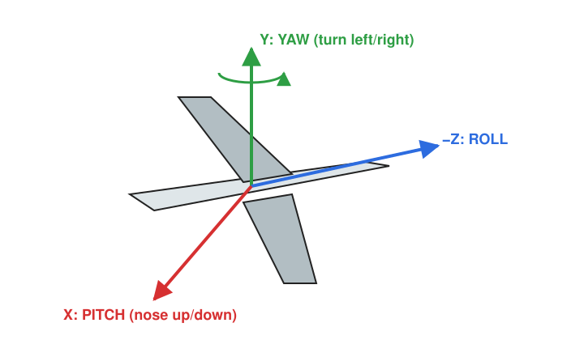
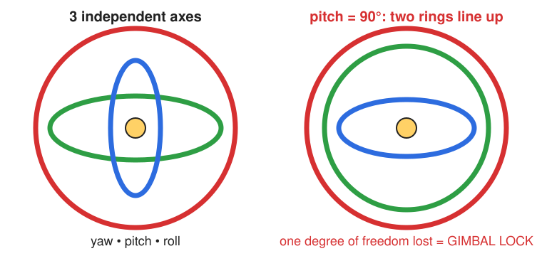
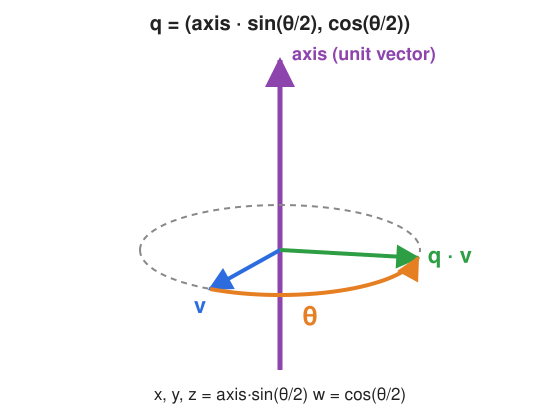
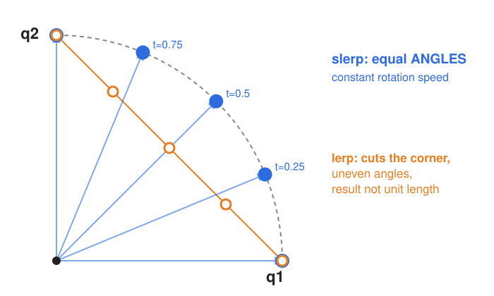
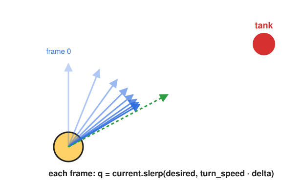

<!-- _class: title -->

# Quaternions
## Rotation in 3D, without the gimbal lock

Games Engines 1 / XR Prototyping
Dr Bryan Duggan · TU Dublin

---

# Questions we will answer today

- What does **Éamon de Valera** have to do with games? 🇮🇪
- How do rotations work in 3D? Yaw, pitch, roll and Euler angles
- What is **gimbal lock**?
- What is a quaternion and how do you make one in Godot?
- How do you rotate a vector, and combine rotations?
- **Slerp**: smoothly turning between two orientations
- A turret that smoothly turns to face a tank
- Summary: what is a quaternion, and what is it used for?

---

# Orientation vs rotation

- **Orientation**: which way an object is facing, relative to a reference (its parent / the world)
- **Rotation**: a turn around an **axis** that takes one orientation to another

An object rotating around an axis through its own centre **spins**; around an external point (the Earth round the Sun) it **revolves**.

**Godot gives you four ways to read/write a Node3D's orientation**

| Property | Type | Notes |
|---|---|---|
| `rotation` / `rotation_degrees` | `Vector3` | **Euler angles** — radians / degrees |
| `quaternion` | `Quaternion` | x, y, z, w |
| `basis` | `Basis` | 3×3 matrix (also holds scale) |
| `transform` | `Transform3D` | basis + origin |

All have `global_` versions too. They are all views of the **same** data — set any one and the others update.

---

# Yaw, pitch and roll



| Name | Axis (Godot) | Motion |
|---|---|---|
| **Yaw** | Y (up) | turn left/right |
| **Pitch** | X (right) | nose up/down |
| **Roll** | Z (forward) | bank / tilt |

```gdscript
rotate_y(angle)                       # yaw around PARENT's Y
rotate_object_local(Vector3.RIGHT, a) # pitch around MY X
rotate_object_local(Vector3.FORWARD, a)  # roll around MY Z
```

---

# Euler angles

Store an orientation as **three angles**, applied one after the other (an *Euler angle sequence*). There are **12** valid orderings: XYZ, XZY, YXZ, YZX, ZXY, ZYX, XYX, XZX, YXY, YZY, ZXZ, ZYZ. Godot's `rotation` uses **YXZ** by default (`rotation_order`).

**Order matters!** Rotate the forward vector (0, 0, −1) by 90° around X and 90° around Y:

| Order | After 1st | After 2nd |
|---|---|---|
| X then Y | (0, 1, 0) | **(0, 1, 0)** — pointing up |
| Y then X | (−1, 0, 0) | **(−1, 0, 0)** — pointing left |

```gdscript
var v = Vector3.FORWARD
print(v.rotated(Vector3.RIGHT, PI/2).rotated(Vector3.UP, PI/2))   # (0, 1, 0)
print(v.rotated(Vector3.UP, PI/2).rotated(Vector3.RIGHT, PI/2))   # (-1, 0, 0)
```

---

# The problems with Euler angles

- **Many representations**: 12 orderings × different conventions in every tool (Blender, Maya, Unity, Godot…)
- **Equality**: (0°, 180°, 0°) and (180°, 0°, 180°) are the same orientation — hard to compare
- **Interpolation**: lerping the three angles separately takes a strange, curved path, and a different path for each ordering
- **Wrap-around**: 359° → 1° should be a 2° turn, not 358°
- **Gimbal lock** 👇

Euler angles are great for **editing** (the inspector shows them) and for simple cases like yaw-only characters. For anything that turns freely in 3D, use **quaternions**.

---

# Gimbal lock



A **gimbal** is a set of rings used to mount gyroscopes and cameras — a hardware version of Euler angles. When the middle axis turns 90°, the outer and inner rings **line up**. Two of the angles now rotate around the **same axis**: a **degree of freedom is lost**. Animations snap and twist strangely.

Example: pitch = 90° (looking straight up). Now changing yaw and changing roll do **the same thing**.

---

# William Rowan Hamilton & Broome Bridge

On **16 October 1843** Hamilton was walking along the **Royal Canal in Dublin** when the solution came to him. He carved it into **Broome Bridge** with his penknife:

$$
i^2 = j^2 = k^2 = ijk = -1
$$

- This marks the discovery of the quaternions
- A plaque on the bridge was unveiled by Taoiseach **Éamon de Valera** (a mathematician and student of quaternions) in **1958**
- There is a walk from Dunsink Observatory to the bridge every 16 October

Quaternions extend **complex numbers**: one **real** part (w) and three **imaginary** parts (x i, y j, z k). You don't need the imaginary maths to use them — just the API.

---

<!-- _class: small -->

# What is a quaternion?



Four numbers **(x, y, z, w)** that represent a **rotation of θ around a unit axis**:

$$
\begin{aligned}
x &= \text{axis}_x \sin(\theta/2) \\
y &= \text{axis}_y \sin(\theta/2) \\
z &= \text{axis}_z \sin(\theta/2) \\
w &= \cos(\theta/2)
\end{aligned}
$$

- Unit axis → the quaternion has length 1 (**unit quaternion**). Only unit quaternions are rotations.
- **No gimbal lock**, easy to **interpolate**, cheap to **combine**, only 4 numbers
- ⚠️ Component order differs between APIs. Godot's constructor is **`Quaternion(x, y, z, w)`**

---

# Worked examples

**90° around Y** (θ/2 = 45°, sin 45 = cos 45 = 0.7071)
$$q = (0,\ 0.7071,\ 0,\ 0.7071)$$

**180° around X** (θ/2 = 90°)
$$q = (1,\ 0,\ 0,\ 0)$$

**No rotation (identity)**: θ = 0 → $q = (0, 0, 0, 1)$ = `Quaternion.IDENTITY`

**60° around the axis (1, 1, 0)** — normalise the axis first! (0.7071, 0.7071, 0); sin 30 = 0.5, cos 30 = 0.866
$$q = (0.3536,\ 0.3536,\ 0,\ 0.866)$$

```gdscript
var q = Quaternion(Vector3.UP, deg_to_rad(90))
print(q)          # (0, 0.707107, 0, 0.707107)
print(q.get_axis(), " ", rad_to_deg(q.get_angle()))   # (0, 1, 0) 90
```

---

# Making quaternions in Godot

```gdscript
# From an axis and an angle — axis MUST be normalised, angle in RADIANS
var q1 = Quaternion(Vector3.UP, deg_to_rad(45))

# The shortest rotation that turns one direction into another
var q2 = Quaternion(Vector3.FORWARD, to_target.normalized())

# From Euler angles (radians)
var q3 = Quaternion.from_euler(Vector3(0, PI / 2, 0))

# From a node / basis
var q4 = global_basis.get_rotation_quaternion()   # strips any scale
var q5 = quaternion                               # Node3D property (local)

# Back to a basis / node
global_basis = Basis(q1)
quaternion = q1

# The rotation that faces a direction
var q6 = Basis.looking_at(dir, Vector3.UP).get_rotation_quaternion()
```

> Never fill in x, y, z, w by hand in game code — use the constructors.

---

# Unit quaternions, inverse and the double cover

- **Length** $\sqrt{x^2 + y^2 + z^2 + w^2}$ must be **1**. Floating point drift after many multiplications → `q = q.normalized()` now and again. `q.is_normalized()` checks.
- **Inverse** (undo the rotation) = the **conjugate** for unit quaternions: $(-x, -y, -z, w)$ → `q.inverse()`
- **q and −q are the same rotation** (θ around axis = 360° − θ around −axis). Slerp handles this for you by taking the shortest path.
- `q1.angle_to(q2)` gives the angle between two orientations
- `q1.dot(q2)` — like vectors; 1 or −1 means the same orientation

```gdscript
var back_again = q.inverse() * (q * v)    # == v
```

---

# Rotating a vector

The `*` operator rotates a `Vector3` by a quaternion

```gdscript
var q = Quaternion(Vector3.UP, deg_to_rad(90))
var v = q * Vector3.FORWARD      # (0, 0, -1) → (-1, 0, 0)  : turned left
```

**Example: whiskers / feelers** for obstacle avoidance — rotate forward 45° each way

```gdscript
var fwd = -global_basis.z
var left_feeler  = Quaternion(Vector3.UP, deg_to_rad(45)) * fwd
var right_feeler = Quaternion(Vector3.UP, deg_to_rad(-45)) * fwd
```

Under the hood this is **conjugation**: $v' = q\,v\,q^{-1}$, where $v$ is written as a *pure* quaternion (x, y, z, 0). Godot does it for you.

---

# Combining rotations: multiply

$$q_{total} = q_2 \cdot q_1 \quad \text{means: apply } q_1 \text{ first, then } q_2$$

- Read **right to left** (like matrices). Two unit quaternions multiply to another unit quaternion.
- **Not commutative**: $q_1 q_2 \neq q_2 q_1$ (remember the Euler order slide)

**Example**: 90° around Y, twice
$(0, 0.7071, 0, 0.7071) \cdot (0, 0.7071, 0, 0.7071) = (0, 1, 0, 0)$ = 180° around Y ✓

**Global vs local axes** — which side you multiply on matters:

```gdscript
var r = Quaternion(Vector3.UP, a)
quaternion = r * quaternion      # rotate around the PARENT's up axis  (yaw)
quaternion = quaternion * r      # rotate around MY OWN up axis
```

---

# For reference: the Hamilton product

$$
\begin{aligned}
(q_1 q_2)_w &= w_1 w_2 - x_1 x_2 - y_1 y_2 - z_1 z_2 \\
(q_1 q_2)_x &= w_1 x_2 + x_1 w_2 + y_1 z_2 - z_1 y_2 \\
(q_1 q_2)_y &= w_1 y_2 - x_1 z_2 + y_1 w_2 + z_1 x_2 \\
(q_1 q_2)_z &= w_1 z_2 + x_1 y_2 - y_1 x_2 + z_1 w_2
\end{aligned}
$$

Check with 90° Y × 90° Y: $w = 0.5 - 0.5 = 0$, $y = 0.5 + 0.5 = 1$ → (0, 1, 0, 0) ✓

Compare: combining two 3×3 matrices takes **27** multiplications; quaternions take **16**. Quaternions are 4 numbers to store, matrices 9.

---

# Example: a quaternion flight camera

Yaw around the **world** up, pitch around the **local** right, stop pitch before looking straight up/down

```gdscript
extends Node3D

@export var turn_speed := 1.5        # radians per second
@export var move_speed := 5.0

func _process(delta: float) -> void:
    var yaw = Input.get_axis("right", "left") * turn_speed * delta
    var pitch = Input.get_axis("down", "up") * turn_speed * delta

    quaternion = Quaternion(Vector3.UP, yaw) * quaternion          # global yaw

    var up_dot = (-global_basis.z).dot(Vector3.UP)                 # 1 = looking straight up
    if not (pitch > 0 and up_dot > 0.95) and not (pitch < 0 and up_dot < -0.95):
        quaternion = quaternion * Quaternion(Vector3.RIGHT, pitch) # local pitch

    quaternion = quaternion.normalized()
    translate(Vector3.FORWARD * Input.get_axis("back", "forward") * move_speed * delta)
```

Roll would be `quaternion * Quaternion(Vector3.FORWARD, roll)`.

---

# Interpolation

**Interpolation** = moving smoothly between two values. For numbers and vectors it is easy:

$$\text{lerp}(a, b, t) = a + (b - a)\,t \qquad t \in [0, 1]$$

For **rotations** it is hard:
- Lerping **Euler angles** → strange paths, gimbal lock, wrap-around
- Lerping **matrices** → the result is no longer a rotation (it squashes)
- Lerping **look vectors** → which way is up?

**Quaternions** have a proper answer: **slerp** — **s**pherical **l**inear int**erp**olation.

---

# Slerp vs lerp



Unit quaternions live on the surface of a 4D sphere. Slerp follows the **great arc** between them:

$$
\text{slerp}(q_1, q_2, t) = \frac{\sin((1-t)\Omega)}{\sin\Omega}\,q_1 + \frac{\sin(t\Omega)}{\sin\Omega}\,q_2
$$

where $\cos\Omega = q_1 \cdot q_2$.

- **Constant angular speed**
- Always unit length
- Shortest path

```gdscript
var q = q1.slerp(q2, t)
```

---

<!-- _class: small -->

# Pattern 1: turn from A to B in a fixed time

Store the start and end, advance `t` from 0 to 1 (like `agent.gd` in the repo)

```gdscript
extends Node3D

@export var target: Node3D
@export var duration := 1.0
var q_start: Quaternion
var q_end: Quaternion
var t := 1.0                       # 1 = finished

func _physics_process(delta: float) -> void:
    if Input.is_action_just_pressed("shoot"):
        var dir = global_position.direction_to(target.global_position)
        q_start = global_basis.get_rotation_quaternion()
        q_end = Basis.looking_at(dir, Vector3.UP).get_rotation_quaternion()
        t = 0.0
    if t < 1.0:
        t = min(t + delta / duration, 1.0)
        global_basis = Basis(q_start.slerp(q_end, t))
```

> `Basis.looking_at` takes a **direction**, not a position. Passing `target.global_position` only works when the node is at the origin!

---

# Pattern 2: smoothly track a moving target



Each frame, slerp a **fraction** of the way from the current rotation to the desired one. Fast at first, slowing as it lines up.

```gdscript
var dir = head.global_position.direction_to(
        target.global_position)
var desired = Basis.looking_at(dir, Vector3.UP) \
        .get_rotation_quaternion()
var current = head.global_basis \
        .get_rotation_quaternion()
var w = min(turn_speed * delta, 1.0)
head.global_basis = Basis(current.slerp(desired, w))
```

`min(…, 1.0)` stops it overshooting on a long frame.

---

# Pattern 3: constant turn rate

Turn at a fixed number of degrees per second (like Unity's `RotateTowards`)

```gdscript
@export var max_turn_deg := 90.0     # degrees per second

func turn_towards(desired: Quaternion, delta: float) -> void:
    var current = global_basis.get_rotation_quaternion()
    var angle = current.angle_to(desired)          # radians between them
    if angle < 0.0001:
        return
    var step = deg_to_rad(max_turn_deg) * delta
    global_basis = Basis(current.slerp(desired, min(step / angle, 1.0)))
```

Or with a **Tween** (Godot slerps `Quaternion` properties for you):

```gdscript
create_tween().tween_property(self, "quaternion", desired, 0.5) \
    .set_trans(Tween.TRANS_SINE).set_ease(Tween.EASE_IN_OUT)
```

---

<!-- _class: tiny -->

# Example: detect the tank and turn the turret

```gdscript
extends Node3D            # turret.gd

@export var missile_scene: PackedScene
@export var turn_speed: float = 3.0
@onready var head: Node3D = $Head
@onready var fire_timer: Timer = $FireTimer
var target: Node3D = null

func _ready() -> void:
    $Range.body_entered.connect(_on_range_body_entered)   # Area3D, SphereShape3D r = 30
    $Range.body_exited.connect(_on_range_body_exited)

func _on_range_body_entered(body: Node3D) -> void:
    if body.is_in_group("tank"):
        target = body
        fire_timer.start()

func _on_range_body_exited(body: Node3D) -> void:
    if body == target:
        target = null
        fire_timer.stop()

func _process(delta: float) -> void:
    if target == null:
        return
    var to_target = (target.global_position - head.global_position).normalized()
    var desired = Basis.looking_at(to_target, Vector3.UP).get_rotation_quaternion()
    var current = head.global_basis.get_rotation_quaternion()
    head.global_basis = Basis(current.slerp(desired, min(turn_speed * delta, 1.0)))
```

Only the **Head** rotates, so the base stays still. Firing & missiles → physics slides.

---

# Turrets that only yaw (and barrels that only pitch)

A real turret: the **head yaws** (Y only) and the **barrel pitches** (local X only)

```gdscript
func _process(delta: float) -> void:
    # 1. Head: flatten the direction so it only turns around Y
    var flat = target.global_position - head.global_position
    flat.y = 0
    if flat.length_squared() > 0.001:
        var want = Basis.looking_at(flat.normalized(), Vector3.UP).get_rotation_quaternion()
        var have = head.global_basis.get_rotation_quaternion()
        head.global_basis = Basis(have.slerp(want, min(turn_speed * delta, 1.0)))

    # 2. Barrel (child of head): pitch angle in the head's local space
    var local = head.to_local(target.global_position)        # -Z is in front
    var pitch = atan2(local.y, -local.z)
    barrel.rotation.x = lerp_angle(barrel.rotation.x, pitch, turn_speed * delta)
```

Combining **vectors** (direction), **trig** (`atan2`) and **quaternions** (slerp).

---

# Quaternions in physics

A rigid body's orientation is stored as a quaternion and integrated every physics step from its **angular velocity** ω (a vector: axis × radians per second)

$$
q \leftarrow q + \frac{\Delta t}{2}\,\omega\,q \qquad \text{then normalise}
$$

where ω is written as the pure quaternion $(\omega_x, \omega_y, \omega_z, 0)$.

- The physics engine does this for every `RigidBody3D`
- Skeletal animation blends bone rotations with slerp
- XR: the headset and controllers report their orientation as quaternions; `XRCamera3D` / `XRController3D` turn them into transforms for you

See the physics slides for torque and angular velocity.

---

# Summary: what is a quaternion?

- A quaternion is a 4D number **(x, y, z, w)** — one real part and three imaginary — discovered by Hamilton in Dublin in 1843.
- A **unit** quaternion represents a **rotation of θ around an axis**: (axis·sin(θ/2), cos(θ/2)).
- Advantages over Euler angles: **no gimbal lock**, combine by **multiplication**, **smooth interpolation** with **slerp**, compact (4 numbers).
- **Application**: smoothly turning a turret / camera / NPC to face a target:

```gdscript
var current = transform.basis.get_rotation_quaternion()
var desired = Basis.looking_at(dir, Vector3.UP).get_rotation_quaternion()
transform.basis = Basis(current.slerp(desired, turn_speed * delta))
```

Other applications: rigid body physics, skeletal animation blending, XR head/hand tracking.

---

# Cheat sheet

| Task | Godot 4 |
|---|---|
| Axis + angle | `Quaternion(axis.normalized(), radians)` |
| From → to direction | `Quaternion(from_dir, to_dir)` |
| Facing a direction | `Basis.looking_at(dir, up).get_rotation_quaternion()` |
| From Euler / to Euler | `Quaternion.from_euler(v)`, `q.get_euler()` |
| Node ↔ quaternion | `quaternion`, `global_basis.get_rotation_quaternion()`, `Basis(q)` |
| Rotate a vector | `q * v` |
| Combine (b after a) | `b * a` |
| Global vs local | `r * q` (parent axes), `q * r` (own axes) |
| Undo | `q.inverse()` |
| Interpolate | `q1.slerp(q2, t)` |
| Angle between | `q1.angle_to(q2)` |
| Keep it valid | `q.normalized()` |

---

# Practice questions

1. Write the quaternion for a rotation of 90° around the X axis. What does it do to (0, 0, −1)?
2. What is gimbal lock? Why don't quaternions suffer from it?
3. What is the difference between `r * quaternion` and `quaternion * r`?
4. Why can't you just lerp Euler angles to turn a character smoothly?
5. Write code to make a camera smoothly turn to face a target, using slerp.
6. Explain why `min(turn_speed * delta, 1.0)` is used as the slerp weight.

**Answers**: 1. (0.7071, 0, 0, 0.7071); 90° around X tips forward up → (0, 1, 0) 2. two axes align, lose a degree of freedom; a quaternion is one rotation around one axis, not three sequenced ones 3. parent/global axis vs own/local axis 4. path depends on order, wraps badly, gimbal lock 5. Pattern 2 6. fraction of the remaining turn each frame; clamped so a long frame can't overshoot past the target
