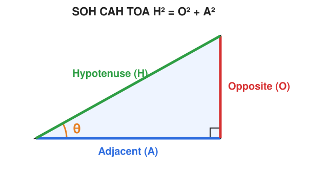
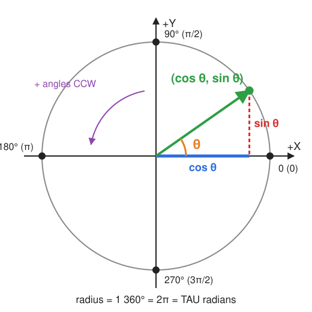
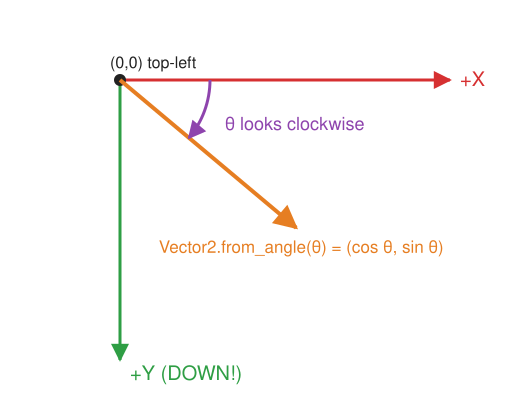
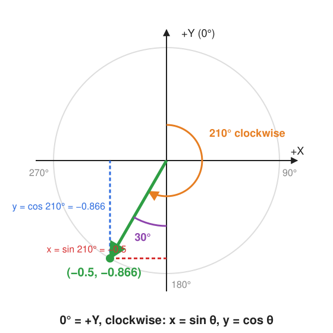
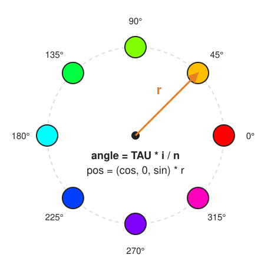
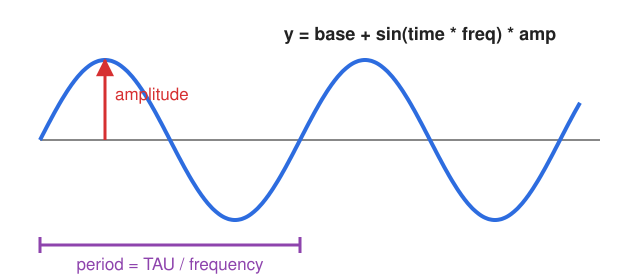
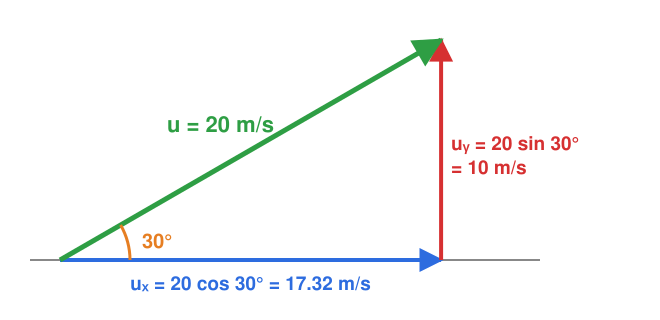
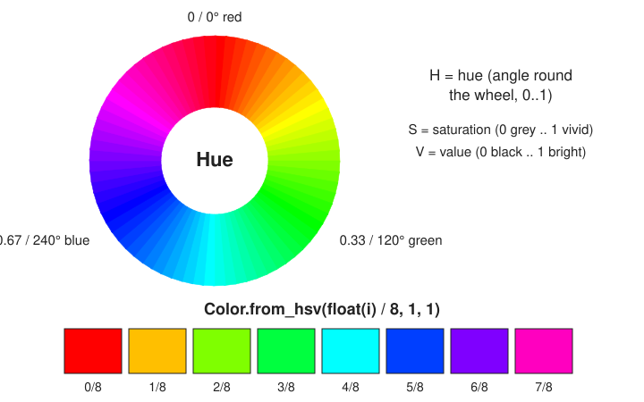

<!-- _class: title -->

# Trigonometry for Games
## Angles, directions, circles & waves in Godot 4

Games Engines 1 / XR Prototyping
Dr Bryan Duggan · TU Dublin

---

# What we will cover

1. Degrees & radians
2. Right-angled triangles — SOH CAH TOA & Pythagoras
3. Inverse functions & `atan2`
4. The unit circle: **angle → direction vector**
5. Angle conventions — *where is 0 and which way is positive?*
6. Worked example: 210° to a direction vector (0° = +Y, clockwise)
7. Angles in Godot 2D and 3D
8. Circles, orbits, spirals and sine waves
9. Resolving a velocity into components (projectiles)
10. Hue is an angle — HSV rainbows
11. Wrapping angles with `lerp_angle`

---

# Why trigonometry?

Any time a game has **an angle** and needs **a direction** (or the other way round):

| Game problem | Trig used |
|---|---|
| A turret has a heading — which way does the bullet go? | angle → vector (`sin`, `cos`) |
| Which way is the player from the enemy? | vector → angle (`atan2`) |
| Place 12 piano keys / enemies / coins in a circle | `cos`, `sin` around a circle |
| Make a coin bob up and down | `sin(time)` |
| Catapult fires at 30° at 20 m/s — how fast is it going up? | resolve into components |
| Give 10 blocks the colours of the rainbow | hue is an angle on the colour wheel |

---

# Degrees and radians

- **Degrees**: a full turn is 360°
- **Radians**: a full turn is $2\pi$ (≈ 6.283). One radian is the angle where the arc length = the radius

$$
\text{radians} = \text{degrees} \times \frac{\pi}{180} \qquad \text{degrees} = \text{radians} \times \frac{180}{\pi}
$$

| Degrees | 0 | 30 | 45 | 60 | 90 | 180 | 270 | 360 |
|---|---|---|---|---|---|---|---|---|
| Radians | 0 | π/6 | π/4 | π/3 | π/2 | π | 3π/2 | 2π |

```gdscript
var r = deg_to_rad(90)      # 1.5708
var d = rad_to_deg(PI)      # 180.0
print(TAU)                  # 6.2831... (TAU = 2 * PI, a full turn)

rotation.y = deg_to_rad(45) # Node3D.rotation is in RADIANS
rotation_degrees.y = 45     # ...or use the degrees version
```

> ⚠️ `sin()`, `cos()`, `atan2()` and `rotation` all use **radians**. Forgetting `deg_to_rad` is the #1 trig bug.

---

# Right-angled triangles: SOH CAH TOA



$$
\sin\theta = \frac{O}{H} \qquad \cos\theta = \frac{A}{H} \qquad \tan\theta = \frac{O}{A} \qquad H^2 = O^2 + A^2
$$

---

# Worked example: a ramp

A ramp is **10 m** long (hypotenuse) and rises at **25°**. How high is it, and how far along the ground does it go?

$$
O = H \sin\theta = 10 \times \sin 25° = 10 \times 0.4226 = 4.23 \text{ m}
$$
$$
A = H \cos\theta = 10 \times \cos 25° = 10 \times 0.9063 = 9.06 \text{ m}
$$

Check with Pythagoras: $\sqrt{4.23^2 + 9.06^2} = \sqrt{17.9 + 82.1} = \sqrt{100} = 10$ ✓

```gdscript
var length = 10.0
var angle = deg_to_rad(25)
var height = length * sin(angle)    # 4.23
var ground = length * cos(angle)    # 9.06
```

---

# Pythagoras = distance

The distance between two points is the hypotenuse of a right-angled triangle

$$
d = \sqrt{(x_2-x_1)^2 + (y_2-y_1)^2 + (z_2-z_1)^2}
$$

**Example**: player at (1, 0, 2), enemy at (4, 0, 6)
$$
d = \sqrt{3^2 + 0^2 + 4^2} = \sqrt{25} = 5 \text{ m}
$$

```gdscript
var d = player.global_position.distance_to(enemy.global_position)   # 5.0
# Same thing:
var d2 = (enemy.global_position - player.global_position).length()

# Faster if you only need to COMPARE distances (no square root):
if player.global_position.distance_squared_to(enemy.global_position) < 30 * 30:
    print("within 30 m")
```

---

# Inverse functions: side lengths → angle

| Know | Use | Godot |
|---|---|---|
| O and H | $\theta = \sin^{-1}(O/H)$ | `asin(o / h)` |
| A and H | $\theta = \cos^{-1}(A/H)$ | `acos(a / h)` |
| O and A | $\theta = \tan^{-1}(O/A)$ | `atan(o / a)` — **better: `atan2(o, a)`** |

**Example**: a ladder 5 m long reaches 3 m up a wall. What angle does it make with the ground?
$$
\theta = \sin^{-1}(3/5) = \sin^{-1}(0.6) = 36.87°
$$

```gdscript
var theta = rad_to_deg(asin(3.0 / 5.0))   # 36.87
```

> `acos` and `asin` only accept values from −1 to 1. Floating point error can give 1.0000001 → `NaN`. Use `clamp(x, -1, 1)` or Godot's `angle_to()` which does this for you.

---

# Why `atan2` and not `atan`?

`atan(y / x)` can't tell (3, 4) from (−3, −4): $\frac{4}{3} = \frac{-4}{-3}$. It only returns −90° … +90°. It also divides by zero when x = 0.

`atan2(y, x)` looks at the **signs** of both and returns the full −180° … +180°.

**Example**: what angle (from +X, anticlockwise) does the vector (−3, 4) make?

| | Result | |
|---|---|---|
| `atan(4 / -3)` | −53.13° | ✗ points into the wrong quadrant |
| `atan2(4, -3)` | **126.87°** | ✓ |

```gdscript
var v = Vector2(-3, 4)
print(rad_to_deg(atan2(v.y, v.x)))   # 126.87
print(rad_to_deg(v.angle()))         # 126.87 — Vector2.angle() calls atan2 for you
```

> Note the order: **`atan2(y, x)`** — y first!

---

# The unit circle: angle → direction



A circle of radius 1. The point at angle θ is

$$
(\cos\theta,\ \sin\theta)
$$

- It **is** a direction vector of length 1 (a *unit vector*), because $\cos^2\theta + \sin^2\theta = 1$
- Multiply by a speed or a radius to scale it

```gdscript
var theta = deg_to_rad(35)
var dir = Vector2(cos(theta), sin(theta))
var velocity = dir * speed
```

This assumes the **maths convention**: 0° along +X, angles increase **anticlockwise**.

---

# Useful values

| θ | 0° | 30° | 45° | 60° | 90° | 120° | 180° | 210° | 270° |
|---|---|---|---|---|---|---|---|---|---|
| sin θ | 0 | 0.5 | 0.707 | 0.866 | 1 | 0.866 | 0 | −0.5 | −1 |
| cos θ | 1 | 0.866 | 0.707 | 0.5 | 0 | −0.5 | −1 | −0.866 | 0 |

**The signs by quadrant** (maths convention):

| Quadrant | Angles | sin | cos |
|---|---|---|---|
| 1 | 0°–90° | + | + |
| 2 | 90°–180° | + | − |
| 3 | 180°–270° | − | − |
| 4 | 270°–360° | − | + |

Handy identities: $\sin(180° + \theta) = -\sin\theta$, $\cos(180° + \theta) = -\cos\theta$, $\sin(90°-\theta) = \cos\theta$

---

# ⚠️ Angle conventions — always ask two questions

1. **Where is 0°?**
2. **Which way is positive — clockwise or anticlockwise?**

| Convention | 0° points | Positive | Direction vector |
|---|---|---|---|
| Maths / unit circle | +X | anticlockwise | $(\cos\theta,\ \sin\theta)$ |
| Compass / bearing | +Y (north) | **clockwise** | $(\sin\theta,\ \cos\theta)$ |
| Godot 2D (`Vector2.from_angle`) | +X | clockwise *on screen* (Y is down) | $(\cos\theta,\ \sin\theta)$ |
| Godot 3D yaw (`rotation.y`) | −Z (forward) | anticlockwise seen from above (turns **left**) | $(-\sin\theta,\ 0,\ -\cos\theta)$ |

**Swapping sin and cos** is how you move between "0 is on X" and "0 is on Y". Changing the direction of rotation flips the sign of one component.

---

<!-- _class: small -->

# Godot 2D: Y points down



The screen origin is the **top-left** and +Y goes **down**. The maths is the same, $(\cos\theta, \sin\theta)$, but because Y is flipped, positive angles look **clockwise**.

```gdscript
var dir = Vector2.from_angle(rotation)     # (cos, sin) of a 2D node's rotation
position += dir * speed * delta            # move "forward" in 2D (+X is forward in 2D)
look_at(get_global_mouse_position())       # or let Godot work out the angle
```

---

<!-- _class: small -->

# Worked example: 210° → direction vector

> *Convert 210° to a 2D direction vector, where 0° points along +Y and angles increase clockwise.*



**Step 1 — pick the formula.** 0° is on **+Y** and positive is **clockwise** (bearing convention):
$$x = \sin\theta \qquad y = \cos\theta$$

**Step 2 — substitute.**
$x = \sin 210° = -\sin 30° = -0.5$
$y = \cos 210° = -\cos 30° = -0.866$

**Step 3 — answer & check.** $(-0.5,\ -0.866)$
Length $= \sqrt{0.25 + 0.75} = 1$ ✓ — down and to the left, 30° past −Y ✓

---

<!-- _class: small -->

# Why x = sin θ and y = cos θ?

Measured from +Y, the angle θ is between the vector and the **Y axis**:

- The side **along Y** is *adjacent* to θ → $y = H\cos\theta$
- The side **along X** is *opposite* θ → $x = H\sin\theta$

Going clockwise from +Y moves towards **+X** first (at 90°), so x is positive for 0°–180° — exactly what $\sin\theta$ does.

**Sanity check** at the four main bearings:

| θ | (sin θ, cos θ) | Points |
|---|---|---|
| 0° | (0, 1) | +Y ✓ |
| 90° | (1, 0) | +X ✓ (clockwise from +Y) |
| 180° | (0, −1) | −Y ✓ |
| 270° | (−1, 0) | −X ✓ |

> Always check your formula against 0° and 90° — it takes 10 seconds and catches sign mistakes.

---

# More practice: bearings → vectors

0° = +Y, clockwise, so $\vec{d} = (\sin\theta, \cos\theta)$

| θ | Working | Vector |
|---|---|---|
| 45° | (sin 45, cos 45) | **(0.707, 0.707)** |
| 120° | (sin 120, cos 120) = (sin 60, −cos 60) | **(0.866, −0.5)** |
| 300° | (sin 300, cos 300) = (−sin 60, cos 60) | **(−0.866, 0.5)** |

**Going backwards** — vector → bearing: swap the arguments of `atan2`
$$\theta = \operatorname{atan2}(x,\ y)$$

```gdscript
var d = Vector2(-0.5, -0.866)
var bearing = rad_to_deg(atan2(d.x, d.y))   # -150
bearing = fposmod(bearing, 360.0)           # 210 ✓  (wrap into 0..360)
```

---

# Godot 3D: yaw → forward vector

In 3D, Godot's forward is **−Z** and `rotation.y` (yaw) turns the node **left** when positive (right-handed, anticlockwise when viewed from above).

$$
\text{forward}(\theta) = (-\sin\theta,\ 0,\ -\cos\theta)
$$

| `rotation_degrees.y` | forward |
|---|---|
| 0 | (0, 0, −1) |
| 90 | (−1, 0, 0) — facing left (−X) |
| 180 | (0, 0, 1) |
| −90 | (1, 0, 0) — facing right (+X) |

You rarely need the formula — Godot keeps it in the **basis**:

```gdscript
var forward = -global_basis.z                         # same result, any rotation
var forward2 = Vector3.FORWARD.rotated(Vector3.UP, rotation.y)  # same again
```

---

# Facing a target with yaw (3D)

To turn a tank (only around Y) to face a target, find the yaw from the direction:

```gdscript
func face(target_pos: Vector3) -> void:
    var dir = target_pos - global_position
    dir.y = 0                                  # ignore height: yaw only
    rotation.y = atan2(-dir.x, -dir.z)         # inverse of (-sin, 0, -cos)
```

Check: target directly to the left, `dir = (-1, 0, 0)` → `atan2(1, 0)` = 90° ✓

Or let Godot do it — `look_at` builds the whole basis for you:

```gdscript
look_at(Vector3(target_pos.x, global_position.y, target_pos.z), Vector3.UP)
```

Smooth turning (rotating a bit each frame) uses **quaternions** — see the quaternion slides.

---

# Placing objects in a circle



Divide a full turn (TAU) by the number of objects:

```gdscript
extends Node3D

@export var scene: PackedScene
@export var count: int = 12
@export var radius: float = 5.0

func _ready() -> void:
    for i in range(count):
        var angle = TAU * i / count
        var obj = scene.instantiate()
        add_child(obj)
        obj.position = Vector3(cos(angle), 0, sin(angle)) * radius
        obj.look_at(global_position)  # face the centre
```

Use `float(i) / count` if both are ints! (`TAU *` makes it float here.)

---

# Orbits and spirals

Make the angle depend on **time** and you get motion:

```gdscript
var angle := 0.0
@export var speed: float = 1.0       # radians per second
@export var radius: float = 3.0

func _process(delta: float) -> void:
    angle += speed * delta
    position = Vector3(cos(angle), 0, sin(angle)) * radius        # orbit

    # spiral: radius grows over time
    # position = Vector3(cos(angle), 0, sin(angle)) * (angle * 0.2)

    # helix: rises as it goes round
    # position = Vector3(cos(angle) * radius, angle * 0.1, sin(angle) * radius)
```

Angular speed ω (rad/s) × radius r = linear speed: $v = \omega r$. At 1 rad/s and r = 3 m the object moves at 3 m/s.

---

<!-- _class: tiny -->

# Sine waves: bobbing, pulsing, swaying



```gdscript
@export var amplitude: float = 0.25
@export var frequency: float = 2.0      # radians per second
var base_y: float
var time := 0.0

func _ready() -> void:
    base_y = position.y

func _process(delta: float) -> void:
    time += delta
    position.y = base_y + sin(time * frequency) * amplitude   # coin bob
    rotate_y(delta)                                           # and spin
    # pulse: scale = Vector3.ONE * (1.0 + 0.1 * sin(time * 5.0))
```

`sin` is always between −1 and 1, so the result is always between `base − amp` and `base + amp`.

---

# Resolving a velocity into components



A catapult fires a ball at **20 m/s**, **30°** above horizontal:

$$
u_x = 20\cos 30° = 17.32 \text{ m/s} \qquad u_y = 20\sin 30° = 10 \text{ m/s}
$$

```gdscript
var a = deg_to_rad(30)
velocity = Vector3(cos(a), sin(a), 0) * 20.0    # (17.32, 10, 0)
```

The physics slides use these numbers to work out the height, time and range.

---

# Hue is an angle: rainbow blocks



**HSV** = Hue, Saturation, Value. **Hue** is a position (angle) around the colour wheel, stored 0..1 in Godot. Sweep one number and you get every colour.

---

# Rainbow code

```gdscript
func colour_blocks(blocks: Array) -> void:
    for i in range(blocks.size()):
        var hue = float(i) / blocks.size()      # float! int / int = 0 for every block
        var mat = StandardMaterial3D.new()      # each block needs ITS OWN material
        mat.albedo_color = Color.from_hsv(hue, 1.0, 1.0)
        blocks[i].get_node("MeshInstance3D").set_surface_override_material(0, mat)
```

**Why HSV and not RGB?**
- In HSV you change **one** number (hue) and keep saturation and brightness constant.
- In RGB you would have to change **all three** channels in a complicated pattern (red→yellow means *raise green*, yellow→green means *lower red*, …).

**Two gotchas**
1. `i / blocks.size()` with ints is **integer division** → 0 → every block is red.
2. Instances of the same scene **share** a material. Change it and *every* block changes. Make a new material (or tick *Local to Scene*).

---

# Wrapping angles: `lerp_angle`

Turning from 350° to 10° should rotate **+20°**, not −340° the long way round.

```gdscript
# ✗ goes the long way round
rotation.y = lerp(rotation.y, target_yaw, 5 * delta)

# ✓ takes the shortest path across the 0/360 boundary
rotation.y = lerp_angle(rotation.y, target_yaw, 5 * delta)

# Keep any angle in a range:
var a = wrapf(angle, -PI, PI)           # -180..180
var b = fposmod(angle_deg, 360.0)       # 0..360
var diff = angle_difference(from, to)   # shortest signed difference (radians)
```

For full 3D orientations this problem gets much worse — that's what **quaternions** and `slerp` solve.

---

# Cheat sheet

| Want | Formula | Godot |
|---|---|---|
| deg ↔ rad | × π/180, × 180/π | `deg_to_rad()`, `rad_to_deg()` |
| Side from angle | O = H sin θ, A = H cos θ | `sin()`, `cos()` |
| Angle from sides | atan2(O, A) | `atan2(y, x)`, `Vector2.angle()` |
| Distance | √(Δx² + Δy² + Δz²) | `a.distance_to(b)` |
| Angle → vector (0 = +X, ccw) | (cos θ, sin θ) | `Vector2.from_angle()` |
| Angle → vector (0 = +Y, cw) | (sin θ, cos θ) | `Vector2(sin(t), cos(t))` |
| 3D yaw → forward | (−sin θ, 0, −cos θ) | `-global_basis.z` |
| Circle of n objects | angle = TAU·i/n | `Vector3(cos(a), 0, sin(a)) * r` |
| Wave | base + sin(t·f)·amp | `sin()` |
| Rainbow | hue = i / n | `Color.from_hsv(h, s, v)` |
| Shortest turn | | `lerp_angle()`, `angle_difference()` |

---

# Practice questions

1. Convert 135° to a direction vector where 0° = +Y and angles increase clockwise. Draw it.
2. Convert 135° to a direction vector in the maths convention (0° = +X, anticlockwise). Why is it different?
3. A Godot 3D node has `rotation_degrees.y = 30`. What is its forward vector?
4. Give the angle of the vector (−4, −4) using `atan2`. Why would `atan` give the wrong answer?
5. Write a script that places 7 blocks in a circle of radius 4 and colours them as a rainbow.

**Answers**: 1. (0.707, −0.707) 2. (−0.707, 0.707) — different 0 and direction 3. (−0.5, 0, −0.866) 4. `atan2(-4, -4)` = −135°; `atan(1)` = 45°, the opposite direction 5. see the circle & rainbow slides
