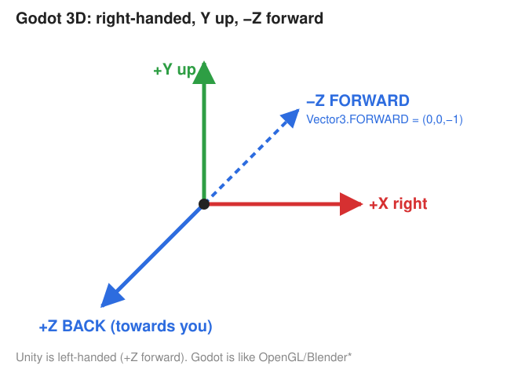
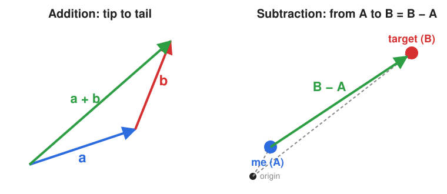
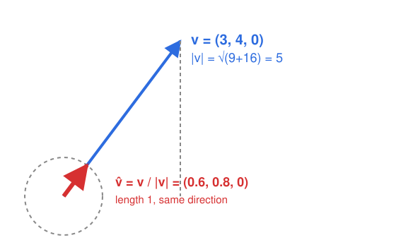
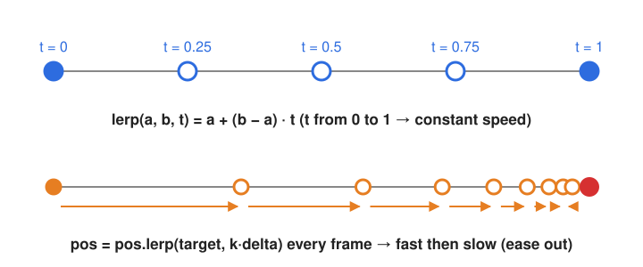
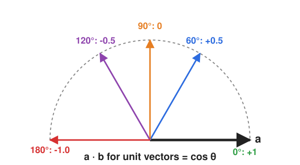
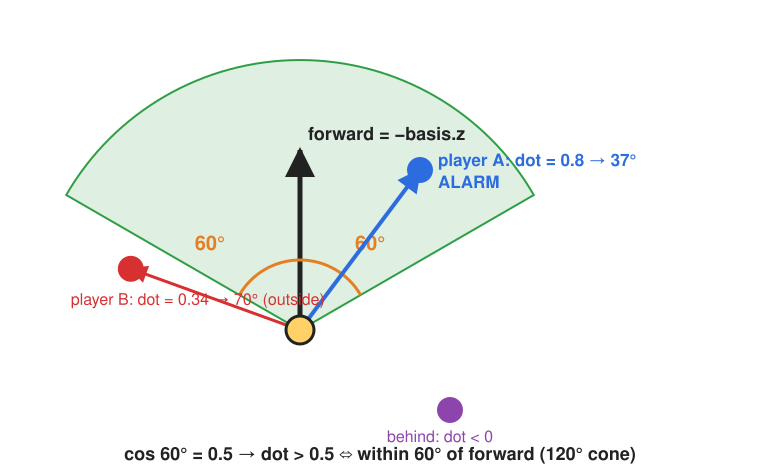
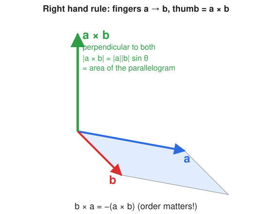
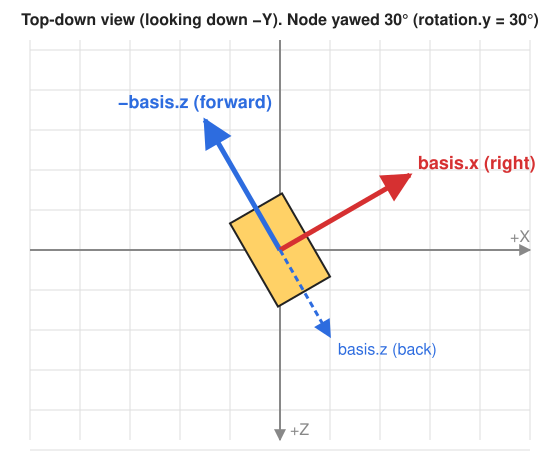
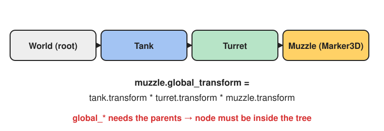
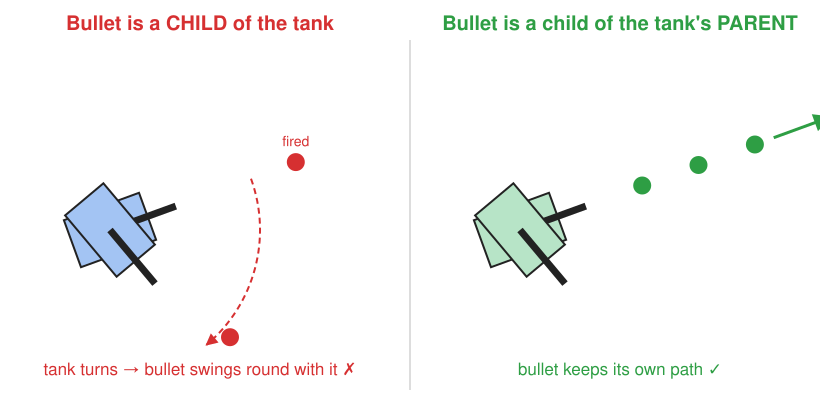

<!-- _class: title -->

# Vectors & Transforms
## The maths of movement in Godot 4

Games Engines 1 / XR Prototyping
Dr Bryan Duggan · TU Dublin

---

# What we will cover

1. Scalars, vectors, points and directions
2. Godot's 3D coordinate system
3. Add, subtract, scale, length, normalise
4. Velocity = speed × direction, frame-rate independent movement
5. Five ways to move between two positions
6. **Dot product** — angles, field of view, front/behind, projection
7. **Cross product** — perpendiculars, left/right, normals, torque
8. **Basis & Transform3D** — local axes, forward vectors
9. Local vs global, parents and children — the bullet bug
10. `look_at`, following cameras

---

# Scalars and vectors

| | What | Examples | Godot |
|---|---|---|---|
| **Scalar** | one number | speed 5 m/s, mass 2 kg, time 0.016 s | `float`, `int` |
| **Vector** | a list of numbers: **magnitude + direction** | position, velocity, force | `Vector2`, `Vector3` |

The **same type** stores two different ideas:

- **Point** (a position): *where* something is, relative to the origin — `global_position`
- **Direction / offset**: *which way* and *how far* — `velocity`, `-basis.z`, `target - position`

```gdscript
var p := Vector3(2, 0, -5)    # a point 2 m right and 5 m in front of the origin
var v := Vector3(0, 0, -3)    # moving forward at 3 m/s
print(p.x, " ", p.y, " ", p.z)
```

**Speed** is a scalar. It is the **magnitude** (length) of the **velocity** vector.

---

<!-- _class: small -->

# Godot's 3D coordinate system



- **Right-handed**, **Y up**
- **−Z is forward**, +Z is back
- Godot colours: **X red, Y green, Z blue**
- Units are **metres** (important for physics and XR — 1 unit = 1 real metre in VR)

| Constant | Value |
|---|---|
| `Vector3.ZERO` | (0, 0, 0) |
| `Vector3.ONE` | (1, 1, 1) |
| `Vector3.UP` / `DOWN` | (0, 1, 0) / (0, −1, 0) |
| `Vector3.RIGHT` / `LEFT` | (1, 0, 0) / (−1, 0, 0) |
| `Vector3.FORWARD` | **(0, 0, −1)** |
| `Vector3.BACK` | (0, 0, 1) |

---

# Adding and subtracting



$$
\mathbf{a} + \mathbf{b} = (a_x + b_x,\ a_y + b_y,\ a_z + b_z) \qquad \mathbf{b} - \mathbf{a} = (b_x - a_x,\ b_y - a_y,\ b_z - a_z)
$$

**Example**: me at (1, 0, 2), target at (4, 0, 6). `to_target = target - me = (3, 0, 4)`

> **"Target minus me"** gives the vector **from me to the target**. Get it backwards and things run away instead of chasing.

---

# Magnitude (length)

$$
|\mathbf{v}| = \sqrt{v_x^2 + v_y^2 + v_z^2}
$$

**Examples**
- $|(3, 0, 4)| = \sqrt{9 + 0 + 16} = 5$
- $|(1, 2, 3)| = \sqrt{1 + 4 + 9} = \sqrt{14} = 3.74$

```gdscript
var v = Vector3(1, 2, 3)
print(v.length())            # 3.7416...
print(v.length_squared())    # 14 — no sqrt, faster for comparisons
print(a.distance_to(b))      # |b - a|
```

The length of a velocity is a **speed**; the length of `target - me` is a **distance**.

---

# Normalising: making a unit vector



A **unit vector** has length 1. It holds **direction only**.

$$
\hat{\mathbf{v}} = \frac{\mathbf{v}}{|\mathbf{v}|}
$$

$(3, 4, 0) \div 5 = (0.6, 0.8, 0)$

```gdscript
var dir = v.normalized()      # returns a new vector, v unchanged
var dir2 = me.direction_to(target)   # (target - me).normalized()
print(dir.is_normalized())    # true
```

> ⚠️ Normalising **(0, 0, 0)** has no direction. Godot returns zero — check the length first if the target could be exactly on top of you.

---

# Scaling: velocity = speed × direction

Multiplying by a scalar changes the length, keeps the direction (negative flips it)

$$
k\mathbf{v} = (k v_x,\ k v_y,\ k v_z)
$$

**Worked example**: a drone at (0, 0, 0) flies towards (6, 0, −8) at 5 m/s. Where is it after 0.5 s?

1. `to_target = (6, 0, -8)`, length = √(36 + 64) = 10
2. `dir = (0.6, 0, -0.8)`
3. `velocity = dir * 5 = (3, 0, -4)`
4. `position += velocity * 0.5` → **(1.5, 0, −2)**

```gdscript
func _physics_process(delta: float) -> void:
    var dir = global_position.direction_to(target.global_position)
    velocity = dir * speed
    global_position += velocity * delta
```

---

# Why multiply by `delta`?

`delta` = seconds since the last frame. Without it, speed is in **metres per frame**.

| Frame rate | Without `delta` (`pos += 0.1`) | With `delta` (`pos += 5 * delta`) |
|---|---|---|
| 30 fps | 3 m/s | 0.167 m per frame → **5 m/s** |
| 90 fps (Quest) | 9 m/s | 0.056 m per frame → **5 m/s** |
| 120 fps | 12 m/s | 0.042 m per frame → **5 m/s** |

```gdscript
# ✗ faster on faster machines
position += Vector3.FORWARD * 0.1
# ✓ 5 metres per second everywhere
position += Vector3.FORWARD * 5.0 * delta
```

`_process(delta)` runs every rendered frame; `_physics_process(delta)` runs at a fixed 60 Hz by default. See the physics slides.

---

<!-- _class: tiny -->

# Moving between two positions

**1. Point at it and move forward**
```gdscript
look_at(target)                                   # -Z now points at the target
translate(Vector3.FORWARD * speed * delta)        # translate() is in LOCAL space
```

**2. Lerp** (fast then slow — eases in to the target)
```gdscript
position = position.lerp(target, 2.0 * delta)
```

**3. Normalised direction × speed × delta**
```gdscript
var to_target = (target - position).normalized()
position += to_target * speed * delta
```

**4. `move_toward`** — constant speed, **never overshoots**
```gdscript
position = position.move_toward(target, speed * delta)
```

**5. A Tween** — fixed duration, easing curves
```gdscript
create_tween().tween_property(self, "position", target, 2.0)
```

---

# Arriving without jittering

With method 3, when the object is closer than `speed * delta` it overshoots, turns round and jitters forever.

```gdscript
func _physics_process(delta: float) -> void:
    var to_target = target - global_position
    var dist = to_target.length()
    var step = speed * delta
    if dist <= step:
        global_position = target           # snap: we've arrived
        arrived.emit()
    else:
        global_position += to_target / dist * step   # dividing by dist = normalising
```

…or just use `move_toward`, which does exactly this.

---

# Lerp: linear interpolation



$$
\text{lerp}(\mathbf{a}, \mathbf{b}, t) = \mathbf{a} + (\mathbf{b} - \mathbf{a})\,t = (1-t)\,\mathbf{a} + t\,\mathbf{b}
$$

- **t from 0 → 1 over time**: constant speed, arrives exactly. `t += delta / duration`
- **`pos = pos.lerp(target, k * delta)` every frame**: covers a fraction of the *remaining* distance — smooth ease-out, never quite arrives. Good for cameras.

Frame-rate-independent version of the second form: `pos.lerp(target, 1.0 - exp(-k * delta))`

---

# The dot product

$$
\mathbf{a}\cdot\mathbf{b} = a_x b_x + a_y b_y + a_z b_z = |\mathbf{a}|\,|\mathbf{b}|\cos\theta
$$

**For unit vectors: $\mathbf{a}\cdot\mathbf{b} = \cos\theta$** — this is incredibly useful!

**Worked example**: $\mathbf{a} = (1, 2, 3)$, $\mathbf{b} = (4, -5, 6)$

$\mathbf{a}\cdot\mathbf{b} = 4 - 10 + 18 = 12$
$\cos\theta = \dfrac{12}{\sqrt{14}\sqrt{77}} = \dfrac{12}{32.83} = 0.366 \Rightarrow \theta = 68.6°$

```gdscript
var d = a.dot(b)                       # 12
var theta = rad_to_deg(a.angle_to(b))  # 68.6 (angle_to normalises & clamps for you)
```

---

# What the dot product tells you



For unit vectors **a** and **b**:

| a · b | Angle | Meaning |
|---|---|---|
| 1 | 0° | same direction |
| 0.5 | 60° | |
| **0** | 90° | **perpendicular** |
| **> 0** | < 90° | **in front** |
| **< 0** | > 90° | **behind** |
| −1 | 180° | opposite |

Comparing with `cos(half_fov)` avoids calling `acos` at all.

---

<!-- _class: small -->

# Example: a guard with a field of view

```gdscript
var forward = -global_transform.basis.z
var to_player = (player.global_position - global_position).normalized()
if forward.dot(to_player) > 0.5:
    sound_alarm()
```



1. `basis.z` is the node's local Z axis in world space. Godot's forward is **−Z**, so negating it gives **forward**.
2. `to_player`: target − me = vector from this node to the player, **normalised** to length 1.
3. Dot of two unit vectors = **cos of the angle** between them.
4. cos 60° = 0.5, so the test is true within **60° either side** of forward → a **120° field of view**.
5. Both are unit vectors, so **distance has no effect** — add a distance check for a range.

---

# Worked numbers for the alarm

The guard is at the origin facing forward, $\text{forward} = (0, 0, -1)$

| Player at | `to_player` (normalised) | dot | Angle | Alarm? |
|---|---|---|---|---|
| (3, 0, −4) | (0.6, 0, −0.8) | **0.8** | 36.9° | ✅ |
| (−4.7, 0, −1.7) | (−0.94, 0, −0.34) | **0.34** | 70° | ❌ outside the cone |
| (2, 0, 3) | (0.55, 0, 0.83) | **−0.83** | 146° | ❌ behind |

A complete vision check — **range + angle + line of sight** (raycast, see physics slides):

```gdscript
@export var view_range := 30.0
@export var fov_degrees := 120.0

func can_see(target: Node3D) -> bool:
    var to_t = target.global_position - global_position
    if to_t.length() > view_range:
        return false
    var cos_half = cos(deg_to_rad(fov_degrees / 2.0))
    return (-global_basis.z).dot(to_t.normalized()) > cos_half
```

---

# Other uses of the dot product

**Projection** — how far along a direction is a point?
```gdscript
var along = (point - origin).dot(dir)      # dir must be unit length
var closest = origin + dir * along         # closest point on the line
```
**Example**: dir = (1, 0, 0), point − origin = (3, 2, 0) → along = 3, closest point (3, 0, 0)

**Are two players facing each other?** `fwd_a.dot(fwd_b) < -0.9`

**Is the ground walkable?** `normal.dot(Vector3.UP) > cos(deg_to_rad(45))`

**Lighting** — brightness of a surface = `max(normal.dot(to_light), 0)` (Lambert)

**Is it moving towards me?** `velocity.dot(to_me) > 0`

---

# The cross product



Gives a **vector perpendicular** to both inputs

$$
\mathbf{a}\times\mathbf{b} = (a_y b_z - a_z b_y,\ \ a_z b_x - a_x b_z,\ \ a_x b_y - a_y b_x)
$$

$|\mathbf{a}\times\mathbf{b}| = |\mathbf{a}||\mathbf{b}|\sin\theta$

**Example 1**: $(1,0,0)\times(0,1,0) = (0,0,1)$ — X × Y = Z

**Example 2**: $(1,2,3)\times(4,5,6)$
$= (2·6 - 3·5,\ 3·4 - 1·6,\ 1·5 - 2·4)$
$= (-3,\ 6,\ -3)$

Check: $(1,2,3)\cdot(-3,6,-3) = -3 + 12 - 9 = 0$ ✓ perpendicular

```gdscript
var c = a.cross(b)
```

---

# Uses of the cross product

**Is the target to my left or right?**
```gdscript
var fwd = -global_basis.z
var side = fwd.cross(to_target).y
if side > 0:   print("left")     # Godot: (0,0,-1) x (-1,0,0) = (0,1,0)
elif side < 0: print("right")
```

**Axis to rotate around** to turn from one direction to another (see quaternions)
```gdscript
var axis = from_dir.cross(to_dir).normalized()
var angle = from_dir.angle_to(to_dir)
```

**Normal of a triangle** (for lighting, collision, procedural meshes)
```gdscript
var normal = (b - a).cross(c - a).normalized()
```

**Torque** = offset × force — see physics slides

**Building a basis**: `right = forward.cross(Vector3.UP)`, `up = right.cross(forward)`

---

# Basis: a node's own axes



A `Basis` is a 3×3 matrix. Its **columns** are the node's local X, Y, Z axes **expressed in the parent's space**:

| | Meaning |
|---|---|
| `basis.x` | local right |
| `basis.y` | local up |
| `basis.z` | local **back** |
| `-basis.z` | local **forward** |

Rotation & scale live in the basis. Use `global_basis` (or `global_transform.basis`) for world-space directions.

---

# Transform3D = Basis + origin

```gdscript
var t: Transform3D = global_transform
t.basis      # rotation and scale (3 axis vectors)
t.origin     # position — same as global_position
```

**Transforming points and directions**
```gdscript
var world_p = global_transform * Vector3(0, 0, -2)   # point 2 m in front of me, in world space
var local_p = global_transform.affine_inverse() * world_p   # back again
var world_d = global_basis * Vector3.FORWARD          # direction only (no origin added)

to_global(Vector3(0, 0, -2))    # Node3D helpers do the same
to_local(enemy.global_position) # where is the enemy relative to me? (z < 0 = in front)
```

**Moving relative to the node's facing**
```gdscript
global_position += -global_basis.z * speed * delta   # forward in world space
translate(Vector3.FORWARD * speed * delta)           # same thing: translate() is LOCAL
rotate_y(turn_speed * delta)                         # yaw
```

---

# Example: moving along basis.z

```gdscript
var v = global_transform.basis.z
global_position = global_position + v * speed * delta
```

- `global_transform.basis` holds the node's rotation; `.z` is its **local Z axis in world space** — a unit vector (if not scaled).
- The second line moves the node along that axis at `speed` m/s, frame-rate independent because of `delta`.
- It respects the node's rotation: turn the node and it moves a different way.
- **Careful**: +Z is **back** in Godot. This moves the node **backwards** — unless the model was built facing +Z (common for imported models, and why `Vector3.MODEL_FRONT` and `use_model_front` exist). For Godot's convention use `-basis.z`.

---

# Local vs global



| Property | Relative to |
|---|---|
| `position`, `rotation`, `transform`, `basis` | the **parent** (local) |
| `global_position`, `global_rotation`, `global_transform`, `global_basis` | the **world** |

A child **inherits** its parent's transform: `global = parent.global_transform * transform`. Move or rotate the parent and every child goes with it.

---

# Example: the bullet bug

```gdscript
var bullet = bullet_scene.instantiate()
bullet.global_position = bullet_spawn.global_position    # ✗ not in the tree yet!
bullet.global_rotation = bullet_spawn.global_rotation
get_parent().add_child(bullet)
```

**Problem**: a global transform depends on the node's parents. Before `add_child`, the bullet has **no parent**, so Godot can't compute it. It reports `!is_inside_tree()` and the bullet appears in the wrong place.

**Fix: add first, then set global values**
```gdscript
var bullet = bullet_scene.instantiate()
get_parent().add_child(bullet)
bullet.global_transform = bullet_spawn.global_transform   # position AND rotation in one go
```

(Setting the **local** `position` before `add_child` is fine — it doesn't need a parent.)

---

# Why add the bullet to the tank's *parent*?



- A child inherits its parent's transform. As a child of the tank, the bullet would **move and rotate with the tank** after it was fired.
- It would also be **deleted** if the tank was `queue_free`d.
- As a sibling, it flies on its own path.

---

# `look_at` and `Basis.looking_at`

```gdscript
look_at(target.global_position, Vector3.UP)    # rotate so -Z points at the target
```

```gdscript
# Build the rotation without applying it (for smoothing with slerp):
var dir = (target.global_position - global_position).normalized()
var b = Basis.looking_at(dir, Vector3.UP)      # takes a DIRECTION, not a position!
```

**Gotchas**
- `look_at` needs the node **in the tree** (it uses global transforms).
- Looking at **your own position** fails (zero direction).
- Looking **straight up or down** fails when `up` is `Vector3.UP` — the direction is parallel to up, so there is no unique "right". Use a different up vector.
- Model faces +Z? `look_at(target, Vector3.UP, true)` (*use_model_front*).

---

<!-- _class: small -->

# Example: a third-person camera

Put a `Marker3D` **behind and above** the tank as a child of the tank, so it moves with it. The camera is **not** a child — it chases the marker smoothly.

```
World
├── Tank (CharacterBody3D)
│   └── CameraTarget (Marker3D)   position (0, 3, 6)  ← behind (+Z) and above
└── Camera3D                      follow_cam.gd
```

```gdscript
extends Camera3D

@export var target: Node3D     # the CameraTarget marker
@export var player: Node3D     # the tank
@export var stiffness := 5.0

func _physics_process(delta: float) -> void:
    var w = 1.0 - exp(-stiffness * delta)                  # frame-rate independent lerp
    global_position = global_position.lerp(target.global_position, w)
    look_at(player.global_position + Vector3.UP, Vector3.UP)
```

Use `_physics_process` if the tank moves in `_physics_process`, or the camera jitters. A `SpringArm3D` stops the camera going through walls.

---

# Vector3 cheat sheet

| Method | Does |
|---|---|
| `a + b`, `a - b`, `a * k`, `a / k` | add, subtract (b − a = from a to b), scale |
| `length()`, `length_squared()` | magnitude |
| `normalized()`, `is_normalized()` | unit vector |
| `distance_to(b)`, `direction_to(b)` | \|b − a\|, (b − a).normalized() |
| `dot(b)`, `angle_to(b)`, `signed_angle_to(b, axis)` | angle stuff |
| `cross(b)` | perpendicular vector |
| `lerp(b, t)`, `slerp(b, t)`, `move_toward(b, d)` | interpolation |
| `limit_length(max)` | clamp a velocity / force |
| `project(b)`, `slide(n)`, `bounce(n)`, `reflect(n)` | projections & bounces |
| `rotated(axis, angle)` | rotate a direction |
| `-global_basis.z`, `global_basis.x`, `global_basis.y` | forward, right, up |
| `to_global(p)`, `to_local(p)` | change space |

---

# Practice questions

1. A is at (2, 0, 1), B at (5, 0, 5). Find the vector from A to B, the distance, and the unit direction.
2. An enemy faces forward (0, 0, −1). The player is at (−2, 0, −4) relative to it. Is the player within a 90° field of view? Show the dot product.
3. Calculate (0, 0, −1) × (1, 0, 0). Is (1, 0, 0) to the left or the right?
4. Why does `bullet.global_position = …` before `add_child` fail?
5. Write three different ways of moving a node to a target position.

**Answers**: 1. (3, 0, 4), 5, (0.6, 0, 0.8) 2. dir = (−0.447, 0, −0.894), dot = 0.894 > cos 45° = 0.707 → yes, 26.6° off forward 3. (0, −1, 0): y < 0 → **right** 4. no parent → global transform can't be computed 5. see slide "Moving between two positions"
